<p align="center">
  <picture>
    <source media="(prefers-color-scheme: dark)" srcset="assets/brand/kerno-horizontal-reversed.svg">
    
  </picture>
</p>

<p align="center">
  Un cliente de bases de datos rápido y nativo para macOS y Linux.<br>
  PostgreSQL, MySQL, MariaDB y SQLite. Escrito en Rust. Código abierto.
</p>

<p align="center">
  <a href="README.md">English</a> · <a href="README.fr.md">Français</a> · <b>Español</b> · <a href="README.ko.md">한국어</a>
</p>

<picture>
  <source media="(prefers-color-scheme: dark)" srcset="docs/screenshots/final/query-results-dark.png">
  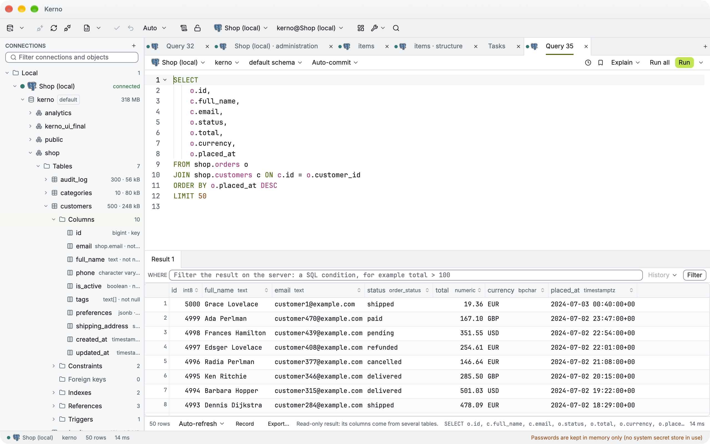
</picture>

Kerno es un cliente de bases de datos que se abre al instante y sigue respondiendo con fluidez: es una
aplicación nativa, no una página web dentro de una ventana. Ofrece la amplitud de DBeaver (árbol de esquemas,
editor SQL, edición de datos, editor de estructura, copias de seguridad, administración) en una interfaz
sobria, clara u oscura.

| | |
|---|---|
| **Arranca en 0,3 s** | 264 ms desde el inicio hasta una ventana utilizable |
| **Se mantiene ligero** | unos 150 MB de memoria con una conexión y una pestaña de consulta abiertas |
| **Recorre un millón de filas** | a la frecuencia completa de la pantalla (8,4 ms por fotograma en una pantalla de 120 Hz) |
| **Muestra las filas al instante** | las primeras filas aparecen de 3 a 6 ms después de que el servidor empieza a enviar |
| **Toda consulta se puede cancelar** | y los resultados llegan por páginas, de modo que la memoria sigue lo que estás viendo |
| **Nada sale de tu equipo** | sin telemetría, sin analítica, sin envío de informes de fallos |

Medido en un Apple M3 Pro; el método y todas las cifras están en [docs/BENCH.md](docs/BENCH.md) (en inglés).

## Contenido

- [Instalación](#instalación)
- [Primeros pasos](#primeros-pasos)
- [Un recorrido](#un-recorrido)
- [Privacidad](#privacidad)
- [Rendimiento](#rendimiento)
- [Documentación](#documentación)
- [Compilar desde el código fuente](#compilar-desde-el-código-fuente)
- [Estado](#estado)
- [Licencia](#licencia)

## Instalación

Descarga el archivo para tu sistema desde la
[última versión](https://github.com/EvanPluchart/kerno/releases/latest). El archivo `SHA256SUMS` de la versión
indica la suma de comprobación de cada archivo.

### macOS (Apple Silicon)

1. Abre `Kerno-<version>-macos-arm64.dmg` y arrastra Kerno a Aplicaciones.
2. La primera vez, macOS indica que no puede comprobar la aplicación, porque la compilación no está
   notarizada por Apple. Abre Ajustes del Sistema ▸ Privacidad y seguridad y haz clic en **Open Anyway**
   (Abrir igualmente). Desde un terminal:
   `xattr -dr com.apple.quarantine /Applications/Kerno.app`.

### Linux (x86_64 y arm64)

| Paquete | Instalación |
|---|---|
| `kerno_<version>_amd64.deb`, `kerno_<version>_arm64.deb` | `sudo apt install ./kerno_<version>_amd64.deb` (Debian, Ubuntu y sus derivadas) |
| `kerno-<version>-linux-x86_64.tar.gz`, `…-aarch64.tar.gz` | `tar -xzf kerno-<version>-linux-x86_64.tar.gz -C ~/.local --strip-components=1`, y después ejecuta `~/.local/bin/kerno` |
| `Kerno-<version>-x86_64.AppImage`, `…-aarch64.AppImage` | `chmod +x Kerno-<version>-x86_64.AppImage`, y después ejecútalo |

Los paquetes funcionan en cualquier distribución con **glibc 2.31 o posterior** (Ubuntu 20.04, Debian 11 y
posteriores). Las bibliotecas que necesitan y las opciones del AppImage están en la
[guía](docs/GUIDE.md#linux) (en inglés).

No hay compilación para Windows.

## Primeros pasos

1. **Añadir una conexión**: pulsa <kbd>Cmd</kbd>+<kbd>N</kbd> (<kbd>Ctrl</kbd>+<kbd>N</kbd> en Linux), elige
   el motor, rellena el host, el usuario y la contraseña, y después pulsa **Test connection** (probar la
   conexión) y **Save and connect** (guardar y conectar). También puedes pegar una URL o iniciar Kerno con
   una: `kerno postgres://ada@db.example.com:5432/shop`.
2. **Explorar**: abre la conexión en la barra lateral. Con doble clic en una tabla se abren sus filas.
3. **Consultar**: <kbd>Cmd</kbd>+<kbd>T</kbd> abre una pestaña de consulta, <kbd>Cmd</kbd>+<kbd>Enter</kbd>
   ejecuta la sentencia en la posición del cursor y <kbd>Cmd</kbd>+<kbd>.</kbd> la cancela.
4. **Encontrar cualquier cosa**: <kbd>Cmd</kbd>+<kbd>K</kbd> abre la paleta de comandos, que lista todas las
   acciones con su atajo.

## Un recorrido

### Conectarse a cualquier destino accesible

<picture>
  <source media="(prefers-color-scheme: dark)" srcset="docs/screenshots/final/v11-ssh-openssh-dark.png">
  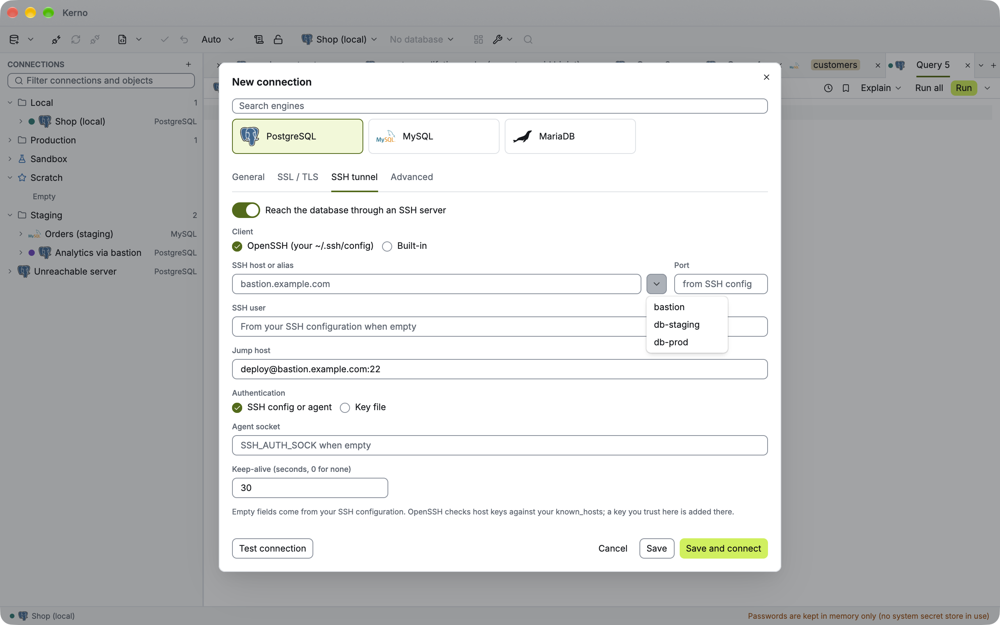
</picture>

- SSL/TLS en todos los modos, con tus certificados.
- Túneles SSH a través de tu propio OpenSSH: los hosts de `~/.ssh/config`, hosts de salto y cadenas de
  bastiones, agentes SSH como 1Password y todos los tipos de clave. Un cliente integrado cubre los inicios de
  sesión con contraseña.
- Las contraseñas se guardan cifradas, en el archivo propio de Kerno o en el llavero del sistema, a elegir.
  También pueden provenir de un comando, de AWS RDS IAM, de 1Password, de `~/.pgpass` o de `~/.my.cnf`.
- Cuando una conexión falla, Kerno primero explica con palabras sencillas lo que ha pasado (host no
  encontrado, conexión rechazada, contraseña incorrecta, fallo de TLS) y qué probar, y después muestra el
  mensaje del propio servidor.

### Un único árbol para todo

<picture>
  <source media="(prefers-color-scheme: dark)" srcset="docs/screenshots/final/navigator-dark.png">
  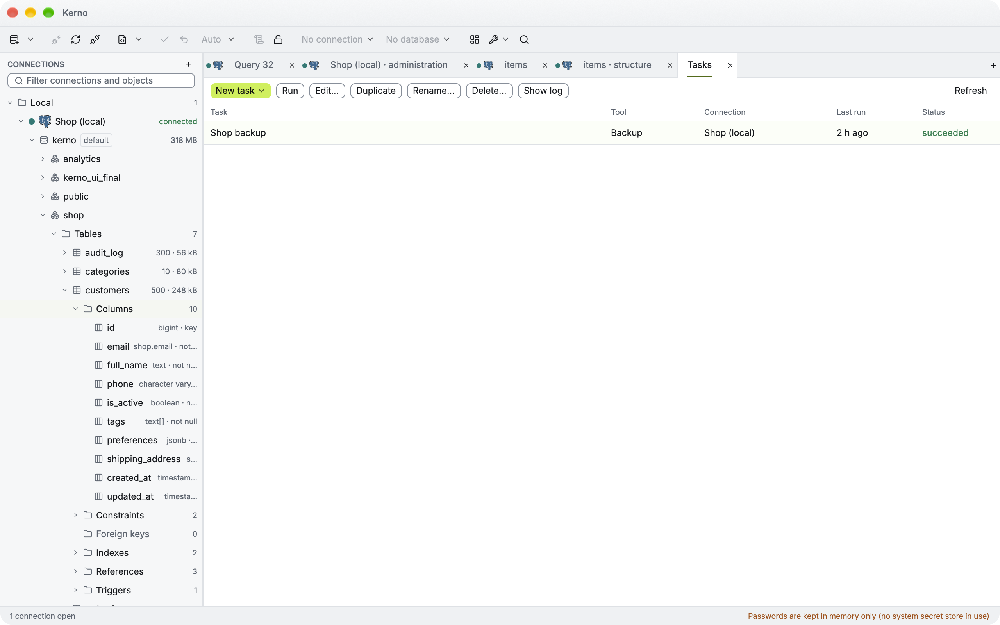
</picture>

Las carpetas y las conexiones son las raíces. Al abrir una conexión se muestran sus bases de datos, esquemas,
tablas, vistas, funciones y el resto, que se cargan a medida que se abren. Las carpetas tienen un color y un
icono. Cada fila responde a un clic derecho: abrir datos, abrir estructura, generar SQL, renombrar, eliminar,
copia de seguridad y más.

### Escribir SQL

<picture>
  <source media="(prefers-color-scheme: dark)" srcset="docs/screenshots/final/explain-plan-dark.png">
  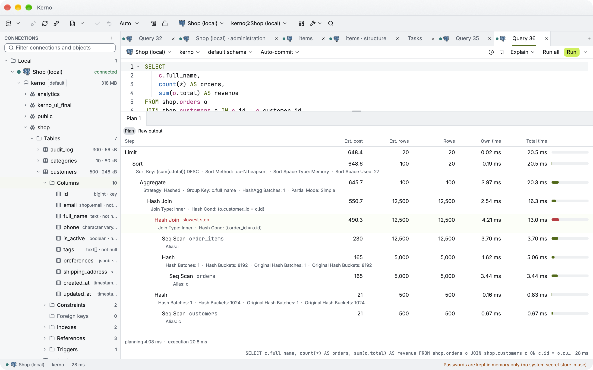
</picture>

- Autocompletado que conoce tus esquemas, tablas, columnas y claves foráneas.
- Ejecuta la sentencia en la posición del cursor, la selección o el script completo, con un resultado por
  sentencia, en pestañas o apilados en un único panel.
- EXPLAIN y EXPLAIN ANALYZE como un árbol legible, con el paso más lento marcado.
- Transacciones por pestaña, historial de consultas, consultas guardadas, parámetros, un formateador,
  búsqueda y reemplazo, varios cursores y un modo vim opcional.
- Ejecuta un mismo script en varias conexiones a la vez, cada una con sus propias reglas.

### Leer resultados, por grandes que sean

<picture>
  <source media="(prefers-color-scheme: dark)" srcset="docs/screenshots/final/v11-grid-find-dark.png">
  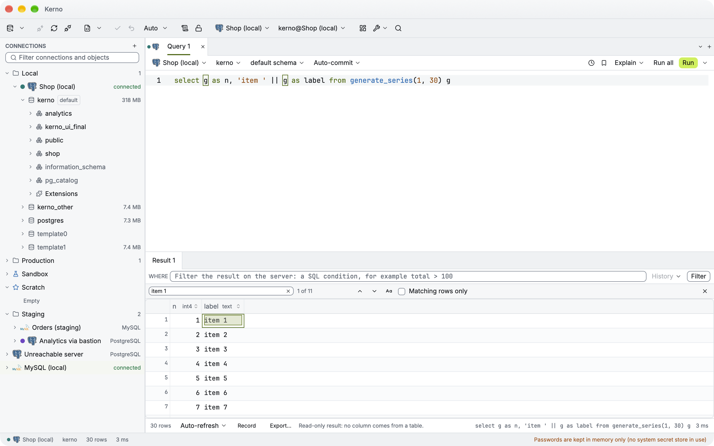
</picture>

Los resultados llegan en flujo y solo se dibuja lo que está en pantalla, de modo que un millón de filas se
desplaza con fluidez. Busca un valor en las filas obtenidas, ordena, oculta y fija columnas, y examina textos
largos, JSON o valores binarios en un visor. Copia como CSV, JSON, Markdown o SQL, y exporta a CSV, JSON, SQL,
Markdown o Excel.

### Editar datos sin sorpresas

<picture>
  <source media="(prefers-color-scheme: dark)" srcset="docs/screenshots/final/table-data-pending-edits-dark.png">
  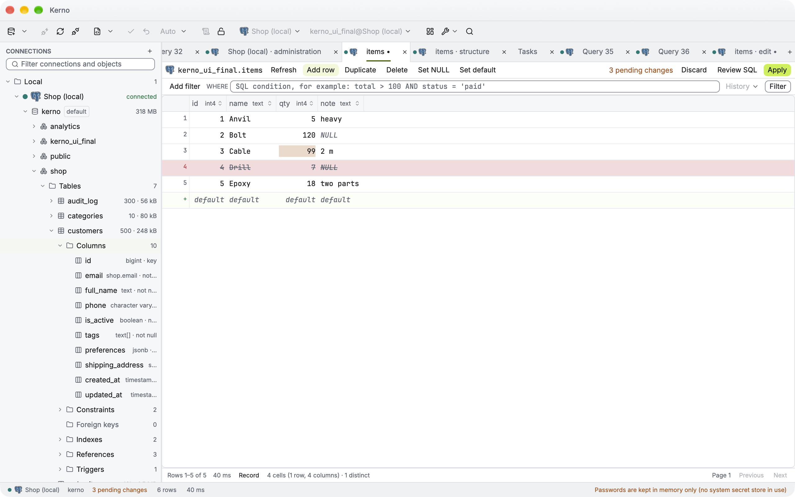
</picture>

Edita las celdas directamente, añade, duplica y elimina filas. No se escribe nada hasta que lo pidas: los
cambios pendientes se resaltan, **Review SQL** (revisar SQL) muestra las sentencias exactas y **Apply**
(aplicar) las ejecuta en una sola transacción. Si una falla, todo se revierte y tus ediciones se conservan.
Un valor también puede ser una expresión SQL como `now()`.

### Diseñar tablas

<picture>
  <source media="(prefers-color-scheme: dark)" srcset="docs/screenshots/final/structure-editor-dark.png">
  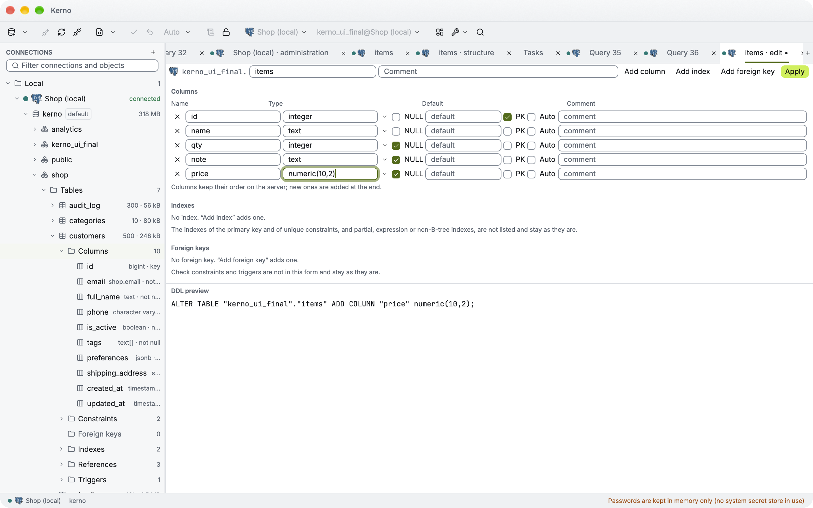
</picture>

Crea y modifica tablas en un formulario (columnas, índices, claves foráneas, comentarios) con una vista previa
en vivo del SQL, que se aplica después de confirmar. Las vistas, funciones y procedimientos se abren como
código fuente que puedes editar.

### Ver cómo se relacionan las tablas

<picture>
  <source media="(prefers-color-scheme: dark)" srcset="docs/screenshots/final/v11-er-diagram-dark.png">
  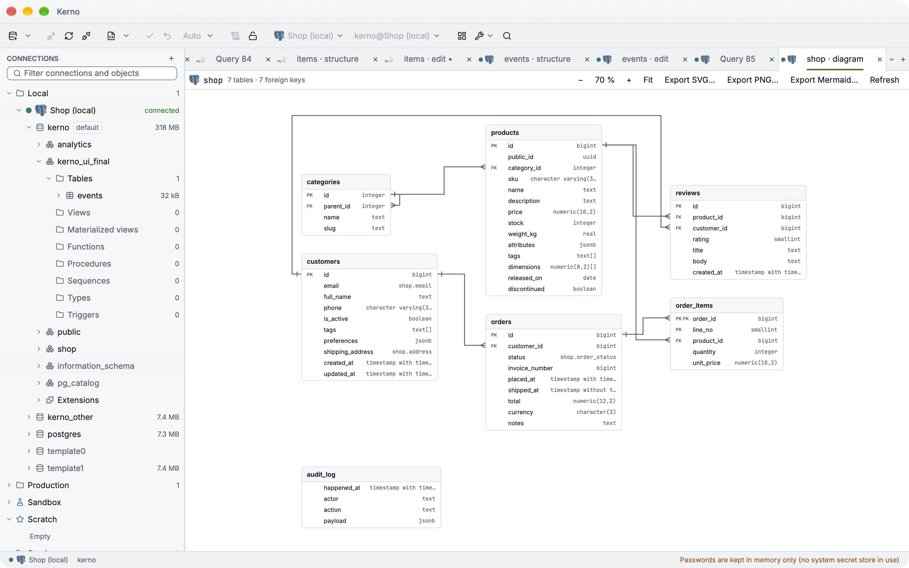
</picture>

Un diagrama ER de un esquema, o de una tabla y sus vecinas, dibujado a partir de las claves foráneas. Desplaza,
amplía, abre una tabla con doble clic y exporta a SVG, PNG o Mermaid.

### La producción permanece protegida

<picture>
  <source media="(prefers-color-scheme: dark)" srcset="docs/screenshots/final/chrome-production-dark.png">
  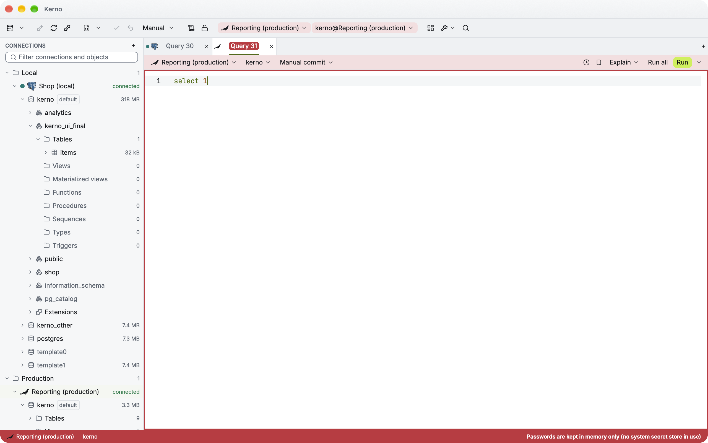
</picture>

Cada conexión tiene un entorno (local, staging, production o uno propio) con un color que tiñe la ventana
mientras está activo, y con sus reglas. Las sentencias destructivas siempre muestran su SQL y piden
confirmación; production pide una segunda confirmación ante cualquier escritura. Una conexión puede ser de
solo lectura, tanto en la aplicación como en el servidor.

### Mover datos

<picture>
  <source media="(prefers-color-scheme: dark)" srcset="docs/screenshots/final/v11-transfer-mapping-dark.png">
  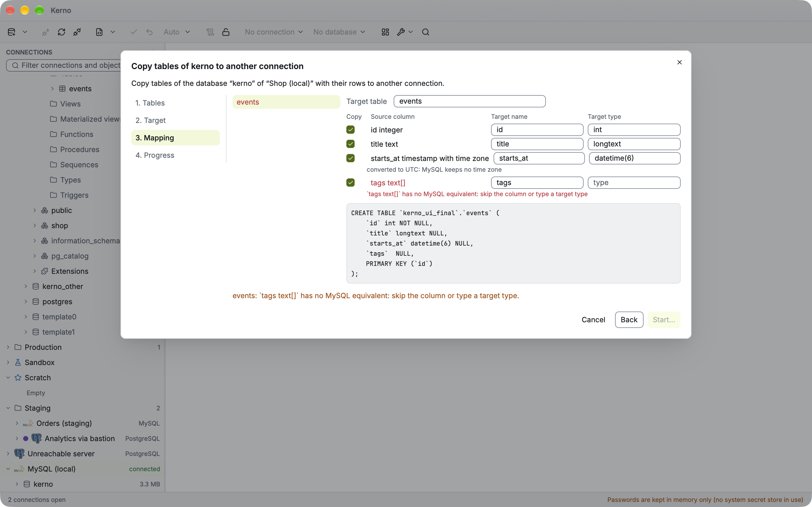
</picture>

- Copia tablas con sus filas a otra conexión, entre PostgreSQL, MySQL y MariaDB en cualquier dirección, con el
  tipo de cada columna visible y editable.
- Copia de seguridad y restauración mediante `pg_dump`, `pg_restore`, `psql`, `mysqldump` y `mysql`, con
  asistentes paso a paso que se pueden guardar como tareas.
- Importa CSV en una tabla nueva o existente.
- Exporta tus conexiones, carpetas y ajustes a un archivo sin ninguna contraseña, e impórtalos en otro equipo.

### Un asistente de IA, solo si lo quieres

<picture>
  <source media="(prefers-color-scheme: dark)" srcset="docs/screenshots/final/v11-ai-write-sql-dark.png">
  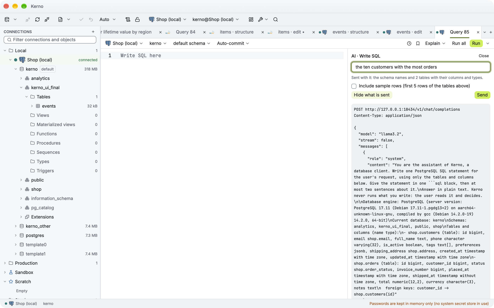
</picture>

Está desactivado hasta que lo actives. Se comunica con el endpoint que elijas, primero un modelo local (Ollama,
LM Studio), y solo cuando pulsas Send (enviar). Puede escribir SQL a partir de una frase y explicar una
consulta, un plan o un error. Envía los nombres de tus tablas y columnas, nunca tus filas, a menos que marques
una casilla para esa petición, y muestra el contenido exacto antes de enviarlo. Nunca ejecuta nada: inserta
SQL para que lo leas y lo ejecutes tú.

### Y además

Una vista de administración (sesiones, bloqueos, roles, tamaños, ajustes), una paleta de comandos, una barra de
herramientas principal, tres disposiciones de pestañas, un archivo de atajos de teclado y `kerno <url>` desde
la terminal. La lista completa, con la prueba que cubre cada elemento, está en
[docs/FEATURES.md](docs/FEATURES.md) (en inglés).

## Privacidad

Kerno no envía nada sobre ti ni sobre tus datos. Además de las conexiones a tus bases de datos, hace dos tipos
de petición:

- **La comprobación de actualizaciones.** Al iniciar y cada 6 horas, una petición a la página de versiones de
  este repositorio, sin ningún identificador. Se desactiva en Settings ▸ Updates o con
  `KERNO_NO_UPDATE_CHECK=1`.
- **El asistente de IA**, solo una vez que lo has activado, solo hacia el endpoint que hayas configurado y solo
  cuando lo pides.

Las contraseñas, las frases de contraseña de SSH y las claves de API nunca se escriben en claro, ni en un
registro. En macOS, Kerno las guarda por defecto en su propio archivo cifrado, en su carpeta de datos, con la
clave en un segundo archivo al lado: nada le pide su contraseña y una copia del archivo no muestra nada, pero un
programa que se ejecute con su cuenta podría leer los dos archivos, como con DBeaver o `~/.pgpass`. Ajustes ▸
Passwords puede guardarlas en el Keychain de macOS: las versiones de Kerno no están firmadas con un Developer ID
de Apple, así que el Keychain vuelve a pedir la contraseña de su sesión tras cada actualización. En Linux siguen
por defecto en el Secret Service. Los detalles están en la [guía](docs/GUIDE.md#where-passwords-are-kept).

## Rendimiento

Compilación de release en un Apple M3 Pro, servidores locales, medianas.

| Medida | Resultado |
|---|---|
| Arranque en frío hasta una ventana utilizable | 264 ms |
| Memoria en reposo, una conexión y una pestaña de consulta | 150 MB |
| Primeras filas en pantalla después de que el servidor empieza a enviar | 3 a 6 ms |
| Desplazamiento de 1.000.000 de filas | 8,4 ms por fotograma (120 Hz) |
| 1.000.000 de filas × 20 columnas obtenidas por completo | 340 MB (17 bytes por celda) |
| Desplazamiento de una tabla de 300 columnas | 8,3 ms por fotograma |
| Apertura de un esquema de 1.200 tablas | 103 ms |
| Ejecución de un archivo `.sql` de 200 MB | 17,7 s, la ventana sigue respondiendo, cancelación en 0,1 s |
| De nuevo utilizable tras la vuelta del servidor | 1,0 s |

[docs/BENCH.md](docs/BENCH.md) contiene el método, los rangos y cómo reproducirlos.

## Documentación

- [Guía](docs/GUIDE.md): SSH, orígenes de contraseñas, el asistente de IA y lo que envía, modo vim,
  actualizaciones, atajos de teclado y el archivo de atajos.
- [Funcionalidades](docs/FEATURES.md): todo lo que funciona, con sus pruebas y capturas de pantalla.
- [Rendimiento](docs/BENCH.md), [arquitectura](docs/ARCHITECTURE.md) (en inglés), [hoja de ruta](docs/ROADMAP.md)
  (en inglés), [decisiones](docs/DECISIONS.md) (en inglés).
- [Contribuir](CONTRIBUTING.md) (en inglés).

## Compilar desde el código fuente

Necesitas Rust (la cadena de herramientas está fijada en `rust-toolchain.toml`; rustup la instala) y, en
macOS, las herramientas de línea de comandos de Xcode.

```sh
cargo build --release -p kerno
cargo run --release -p kerno
```

En Debian o Ubuntu, instala primero las bibliotecas del sistema con `sudo scripts/install-linux-deps.sh`. El
empaquetado, las comprobaciones locales y las bases de datos de prueba se describen en la
[guía](docs/GUIDE.md#build-from-source).

## Estado

Versión 0.3.0. Cubre PostgreSQL, MySQL, MariaDB y SQLite en macOS (Apple Silicon) y Linux
(x86_64 y arm64). Otros motores, la comparación de datos y más están en la [hoja de ruta](docs/ROADMAP.md).

## Licencia

MIT OR Apache-2.0, a tu elección: [LICENSE-MIT](LICENSE-MIT) y [LICENSE-APACHE](LICENSE-APACHE).
Los avisos de terceros, incluidos DBeaver y los logotipos de los motores, están en
[THIRD_PARTY_NOTICES.md](THIRD_PARTY_NOTICES.md) (en inglés).
