<p align="center">
  <picture>
    <source media="(prefers-color-scheme: dark)" srcset="assets/brand/kerno-horizontal-reversed.svg">
    
  </picture>
</p>

<p align="center">
  Un client de base de données rapide et natif pour macOS et Linux.<br>
  PostgreSQL, MySQL, MariaDB et SQLite. Écrit en Rust. Open source.
</p>

<p align="center">
  <a href="README.md">English</a> · <b>Français</b> · <a href="README.es.md">Español</a> · <a href="README.ko.md">한국어</a>
</p>

<picture>
  <source media="(prefers-color-scheme: dark)" srcset="docs/screenshots/final/query-results-dark.png">
  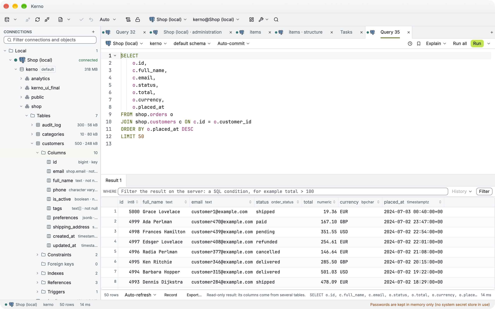
</picture>

Kerno est un client de base de données qui s'ouvre tout de suite et reste réactif : c'est une application
native, pas une page web dans une fenêtre. Il couvre ce que couvre DBeaver (arbre des schémas, éditeur SQL,
édition des données, éditeur de structure, sauvegarde, administration) dans une interface calme, claire ou
sombre.

| | |
|---|---|
| **Démarre en 0,3 s** | 264 ms du lancement à une fenêtre utilisable |
| **Reste léger** | environ 150 Mo de mémoire avec une connexion et un onglet de requête ouverts |
| **Fait défiler un million de lignes** | à la fréquence de l'écran (8,4 ms par image sur un écran 120 Hz) |
| **Affiche les lignes tout de suite** | les premières lignes apparaissent 3 à 6 ms après le début de l'envoi par le serveur |
| **Toute requête peut être annulée** | et les résultats arrivent par pages : la mémoire suit ce que vous regardez |
| **Rien ne quitte votre ordinateur** | pas de télémétrie, pas de statistiques, pas d'envoi de rapports de plantage |

Mesuré sur un Apple M3 Pro ; la méthode et tous les chiffres sont dans [docs/BENCH.md](docs/BENCH.md) (en
anglais).

## Sommaire

- [Installation](#installation)
- [Premiers pas](#premiers-pas)
- [Tour d'horizon](#tour-dhorizon)
- [Vie privée](#vie-privée)
- [Performances](#performances)
- [Documentation](#documentation)
- [Compiler depuis les sources](#compiler-depuis-les-sources)
- [État du projet](#état-du-projet)
- [Licence](#licence)

## Installation

Téléchargez le fichier qui correspond à votre système depuis la
[dernière version](https://github.com/EvanPluchart/kerno/releases/latest). Le fichier `SHA256SUMS` de la
version donne la somme de contrôle de chaque fichier.

### macOS (Apple Silicon)

1. Ouvrez `Kerno-<version>-macos-arm64.dmg` et glissez Kerno dans Applications.
2. Au premier lancement, macOS dit qu'il ne peut pas vérifier l'application, parce que cette version n'est
   pas notarisée par Apple. Ouvrez Réglages Système ▸ Confidentialité et sécurité et cliquez sur
   **Ouvrir quand même** (**Open Anyway**). Depuis un terminal :
   `xattr -dr com.apple.quarantine /Applications/Kerno.app`.

### Linux (x86_64 et arm64)

| Paquet | Installation |
|---|---|
| `kerno_<version>_amd64.deb`, `kerno_<version>_arm64.deb` | `sudo apt install ./kerno_<version>_amd64.deb` (Debian, Ubuntu et leurs dérivés) |
| `kerno-<version>-linux-x86_64.tar.gz`, `…-aarch64.tar.gz` | `tar -xzf kerno-<version>-linux-x86_64.tar.gz -C ~/.local --strip-components=1`, puis lancez `~/.local/bin/kerno` |
| `Kerno-<version>-x86_64.AppImage`, `…-aarch64.AppImage` | `chmod +x Kerno-<version>-x86_64.AppImage`, puis lancez-le |

Les paquets fonctionnent sur toute distribution avec **glibc 2.31 ou plus récent** (Ubuntu 20.04, Debian 11
et suivantes). Les bibliothèques nécessaires et les options de l'AppImage sont dans le
[guide](docs/GUIDE.md#linux) (en anglais).

### Windows (x86_64, aperçu)

`Kerno-<version>-windows-x86_64-setup.exe` installe Kerno pour votre compte seulement, sans droits
d'administrateur, avec une entrée dans le menu Démarrer et un désinstalleur.
`kerno-<version>-windows-x86_64.zip` est la même application sans rien installer : décompressez-le et lancez
`kerno.exe`. Windows peut signaler un éditeur inconnu (SmartScreen : **Informations complémentaires**, puis
**Exécuter quand même**) : les fichiers ne sont pas signés.

C'est un aperçu : ses tests tournent sous Windows contre de vrais serveurs PostgreSQL et MySQL à chaque
changement, et l'installeur comme la mise à jour y sont essayés par des scripts, mais personne ne l'a encore
utilisé à la main sur un bureau Windows. Kerno y vérifie les mises à jour et les installe ; vos `pg_dump` et
`mysqldump` installés, le `pgpass.conf` de libpq et l'OpenSSH du système servent comme sur les autres
systèmes. Ce qui reste est dans la [feuille de route](docs/ROADMAP.md).

## Premiers pas

L'interface de Kerno est en anglais : les noms de boutons et de menus ci-dessous sont ceux de l'application.

1. **Ajouter une connexion** : appuyez sur <kbd>Cmd</kbd>+<kbd>N</kbd> (<kbd>Ctrl</kbd>+<kbd>N</kbd> sous
   Linux), choisissez le moteur, renseignez l'hôte, l'utilisateur et le mot de passe, puis
   **Test connection** et **Save and connect**. Vous pouvez aussi coller une URL, ou lancer Kerno avec une
   URL : `kerno postgres://ada@db.example.com:5432/shop`.
2. **Parcourir** : ouvrez la connexion dans la barre latérale. Un double clic sur une table ouvre ses lignes.
3. **Interroger** : <kbd>Cmd</kbd>+<kbd>T</kbd> ouvre un onglet de requête, <kbd>Cmd</kbd>+<kbd>Entrée</kbd>
   exécute l'instruction sous le curseur, <kbd>Cmd</kbd>+<kbd>.</kbd> l'annule.
4. **Tout trouver** : <kbd>Cmd</kbd>+<kbd>K</kbd> ouvre la palette de commandes, qui liste chaque action
   avec son raccourci.

## Tour d'horizon

### Se connecter à tout ce qui est joignable

<picture>
  <source media="(prefers-color-scheme: dark)" srcset="docs/screenshots/final/v11-ssh-openssh-dark.png">
  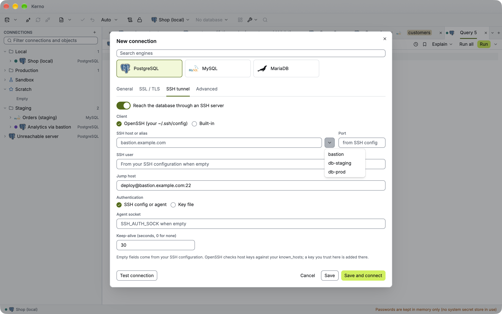
</picture>

- SSL/TLS dans tous les modes, avec vos certificats.
- Tunnels SSH par votre propre OpenSSH : les hôtes de `~/.ssh/config`, les hôtes de rebond et les chaînes
  de bastions, les agents SSH comme 1Password, et tous les types de clés. Un client intégré couvre les
  connexions par mot de passe.
- Les mots de passe sont enregistrés chiffrés, dans le fichier de Kerno ou dans le trousseau du système, au
  choix. Ils peuvent aussi venir d'une commande, d'AWS RDS IAM, de 1Password, de `~/.pgpass` ou de `~/.my.cnf`.
- Quand une connexion échoue, Kerno dit d'abord ce qui s'est passé en mots simples (hôte introuvable,
  connexion refusée, mauvais mot de passe, échec TLS) et quoi essayer, puis montre le message du serveur.

### Un seul arbre pour tout

<picture>
  <source media="(prefers-color-scheme: dark)" srcset="docs/screenshots/final/navigator-dark.png">
  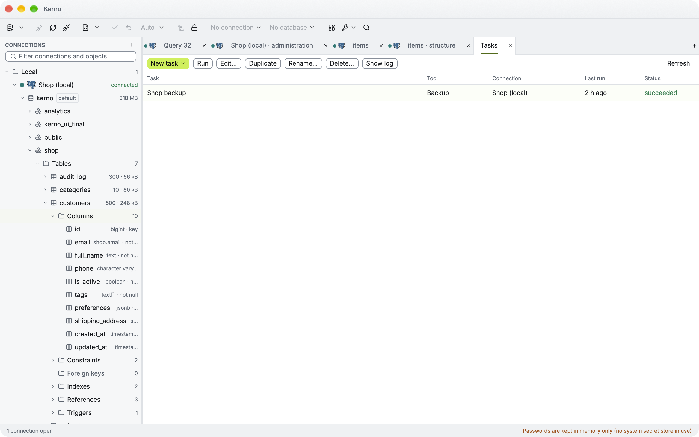
</picture>

Les dossiers et les connexions sont les racines. Ouvrir une connexion montre ses bases, ses schémas, ses
tables, ses vues, ses fonctions et le reste, chargés à mesure que vous les ouvrez. Les dossiers ont une
couleur et une icône. Chaque ligne répond au clic droit : ouvrir les données, ouvrir la structure, générer
du SQL, renommer, supprimer, sauvegarder, et d'autres actions.

### Écrire du SQL

<picture>
  <source media="(prefers-color-scheme: dark)" srcset="docs/screenshots/final/explain-plan-dark.png">
  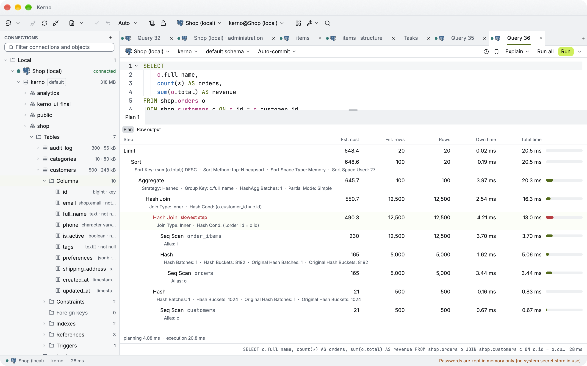
</picture>

- Une complétion qui connaît vos schémas, vos tables, vos colonnes et vos clés étrangères.
- Exécution de l'instruction sous le curseur, de la sélection ou du script entier, avec un résultat par
  instruction, en onglets ou empilés dans un seul panneau.
- EXPLAIN et EXPLAIN ANALYZE sous forme d'arbre lisible, l'étape la plus lente marquée.
- Transactions par onglet, historique des requêtes, requêtes enregistrées, paramètres, formateur, rechercher
  et remplacer, curseurs multiples, et un mode vim optionnel.
- Exécution d'un même script sur plusieurs connexions à la fois, chacune avec ses propres règles.

### Lire des résultats, même très grands

<picture>
  <source media="(prefers-color-scheme: dark)" srcset="docs/screenshots/final/v11-grid-find-dark.png">
  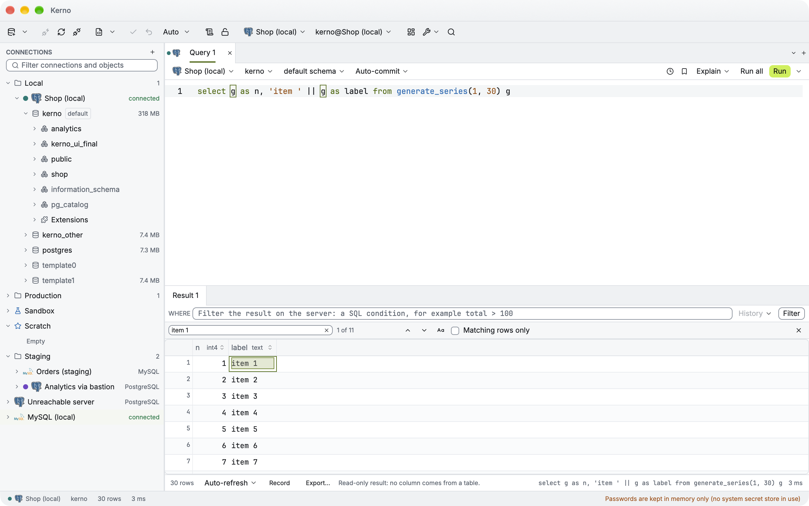
</picture>

Les résultats arrivent en flux et seul ce qui est à l'écran est dessiné : un million de lignes défilent sans
à-coups. Cherchez une valeur dans les lignes chargées, triez, masquez et épinglez des colonnes, et regardez
les longs textes, le JSON ou les valeurs binaires dans une visionneuse. Copiez en CSV, JSON, Markdown ou
SQL, et exportez en CSV, JSON, SQL, Markdown ou Excel.

### Modifier les données sans surprise

<picture>
  <source media="(prefers-color-scheme: dark)" srcset="docs/screenshots/final/table-data-pending-edits-dark.png">
  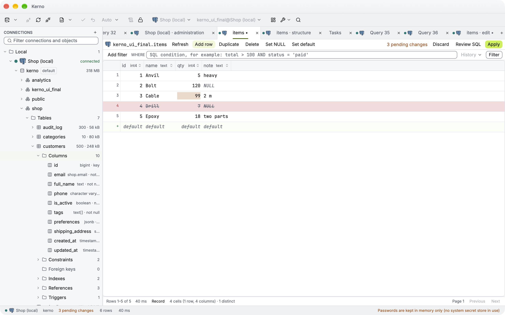
</picture>

Modifiez les cellules sur place, ajoutez, dupliquez et supprimez des lignes. Rien n'est écrit tant que vous
ne le demandez pas : les modifications en attente sont mises en évidence, **Review SQL** montre les
instructions exactes, et **Apply** les exécute dans une seule transaction. Si l'une échoue, tout est annulé
et vos modifications sont conservées. Une valeur peut aussi être une expression SQL comme `now()`.

### Concevoir des tables

<picture>
  <source media="(prefers-color-scheme: dark)" srcset="docs/screenshots/final/structure-editor-dark.png">
  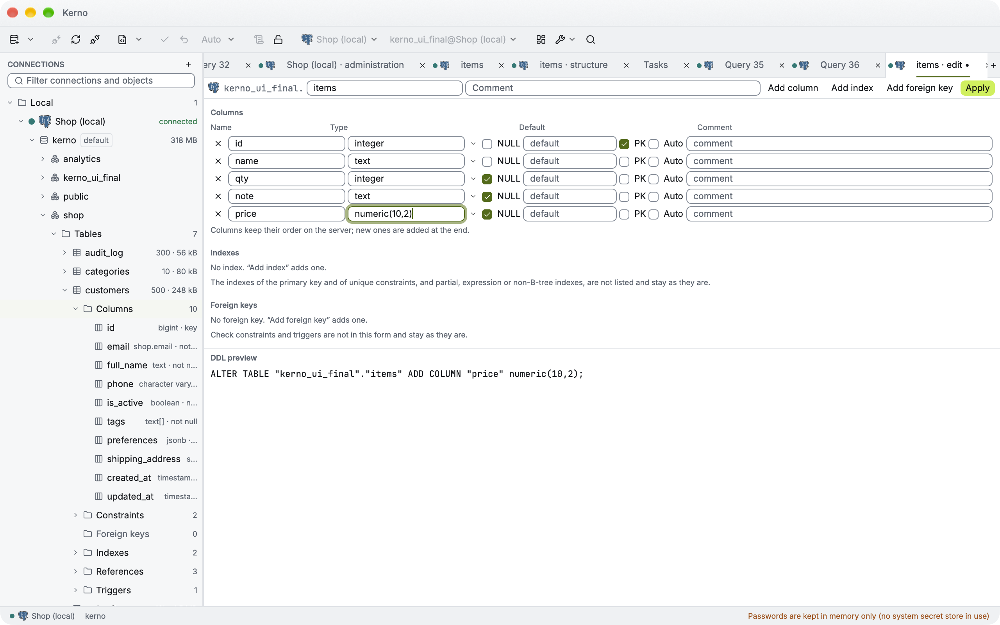
</picture>

Créez et modifiez des tables dans un formulaire (colonnes, index, clés étrangères, commentaires) avec un
aperçu du SQL mis à jour à chaque changement, appliqué après votre confirmation. Les vues, les fonctions et
les procédures s'ouvrent sous forme de source modifiable.

### Voir les liens entre les tables

<picture>
  <source media="(prefers-color-scheme: dark)" srcset="docs/screenshots/final/v11-er-diagram-dark.png">
  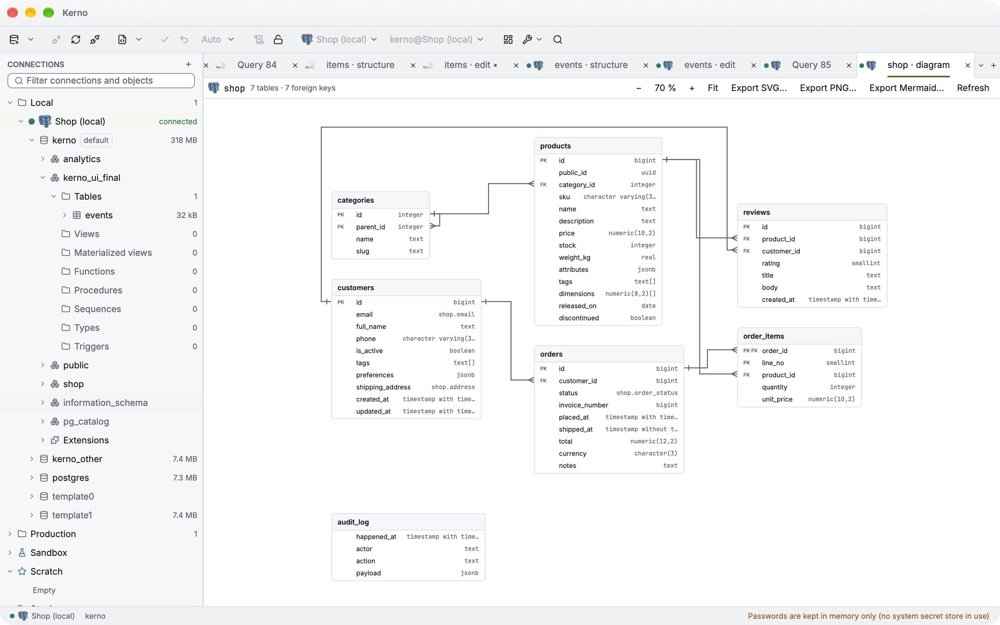
</picture>

Le diagramme entité-relation d'un schéma, ou d'une table et de ses voisines, dessiné à partir des clés
étrangères. Déplacez-vous, zoomez, ouvrez une table par un double clic, et exportez en SVG, PNG ou Mermaid.

### La production reste protégée

<picture>
  <source media="(prefers-color-scheme: dark)" srcset="docs/screenshots/final/chrome-production-dark.png">
  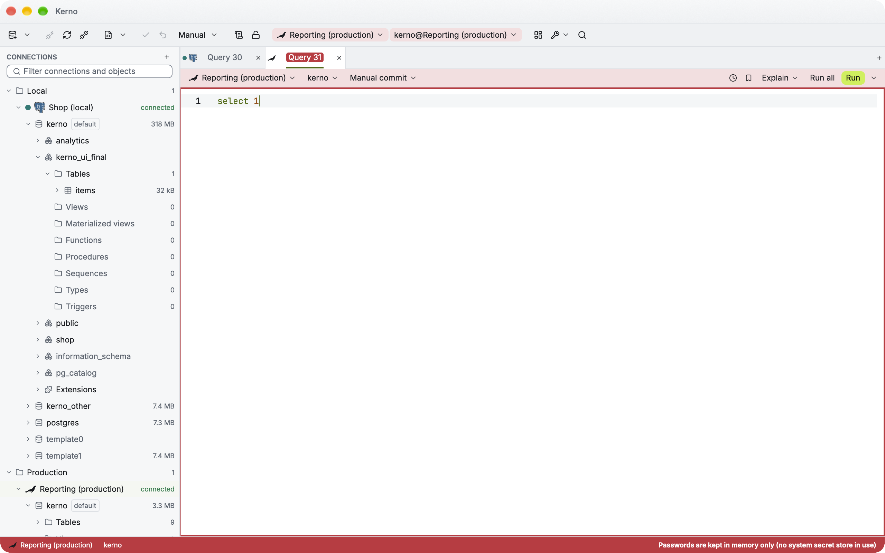
</picture>

Chaque connexion a un environnement (local, staging, production, ou les vôtres) avec une couleur qui teinte
la fenêtre tant qu'elle est active, et des règles. Les instructions destructrices montrent toujours leur SQL
et demandent confirmation ; la production demande une seconde fois pour toute écriture. Une connexion peut
être en lecture seule, dans l'application et sur le serveur.

### Déplacer des données

<picture>
  <source media="(prefers-color-scheme: dark)" srcset="docs/screenshots/final/v11-transfer-mapping-dark.png">
  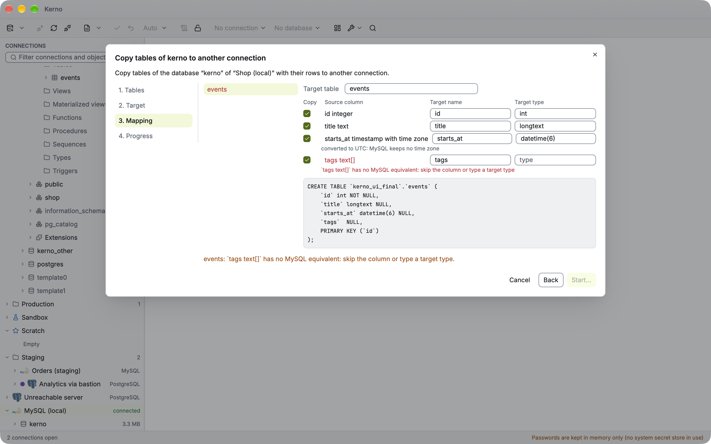
</picture>

- Copie de tables avec leurs lignes vers une autre connexion, entre PostgreSQL, MySQL et MariaDB dans tous
  les sens, le type de chaque colonne étant affiché et modifiable.
- Sauvegarde et restauration par `pg_dump`, `pg_restore`, `psql`, `mysqldump` et `mysql`, dans des
  assistants pas à pas qui peuvent être enregistrés comme tâches.
- Import de CSV dans une table nouvelle ou existante.
- Export de vos connexions, de vos dossiers et de vos réglages dans un fichier sans aucun mot de passe, et
  import ailleurs.

### Un assistant IA, seulement si vous le voulez

<picture>
  <source media="(prefers-color-scheme: dark)" srcset="docs/screenshots/final/v11-ai-write-sql-dark.png">
  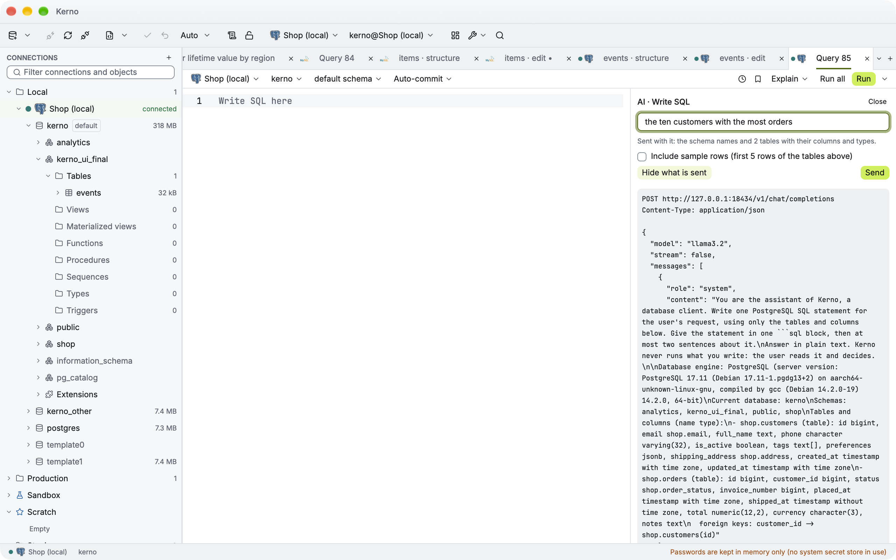
</picture>

Éteint tant que vous ne l'allumez pas. Il parle au point d'accès que vous choisissez, un modèle local
d'abord (Ollama, LM Studio), et seulement quand vous cliquez sur Send. Il peut écrire du SQL à partir d'une
phrase et expliquer une requête, un plan ou une erreur. Il envoie les noms de vos tables et de vos colonnes,
jamais vos lignes sauf si vous cochez une case pour cette demande, et il montre le contenu exact avant
l'envoi. Il n'exécute jamais rien : il insère du SQL que vous lisez et exécutez vous-même.

### Et aussi

Une vue d'administration (sessions, verrous, rôles, tailles, paramètres), une palette de commandes, une
barre d'outils principale, trois dispositions d'onglets, un fichier de raccourcis, et `kerno <url>` depuis
le terminal. La liste complète, avec le test qui couvre chaque élément, est dans
[docs/FEATURES.md](docs/FEATURES.md) (en anglais).

## Vie privée

Kerno n'envoie rien sur vous ni sur vos données. En dehors des connexions à vos bases, il fait deux sortes
de requêtes :

- **La vérification des mises à jour.** Au lancement puis toutes les 6 heures, une requête vers la page des
  versions de ce dépôt, sans aucun identifiant ; quand une version plus récente existe, une seconde lit les
  notes de cette version. Désactivez-la dans Settings ▸ Updates ou avec
  `KERNO_NO_UPDATE_CHECK=1`.
- **L'assistant IA**, seulement après que vous l'avez allumé, seulement vers le point d'accès que vous avez
  indiqué, seulement quand vous le demandez.

Les mots de passe, les phrases secrètes SSH et les clés d'API ne sont jamais écrits en clair, ni dans un
journal. Sous macOS, Kerno les garde par défaut dans son propre fichier chiffré, dans son dossier de données,
la clé dans un second fichier à côté : rien ne demande votre mot de passe, et une copie du fichier ne montre
rien, mais un programme lancé sous votre compte pourrait lire les deux fichiers, comme avec DBeaver ou
`~/.pgpass`. Réglages ▸ Passwords peut les garder dans le Trousseau de macOS à la place : les versions de Kerno
ne sont pas signées avec un identifiant Developer ID d'Apple, le Trousseau redemande alors votre mot de passe
de session après chaque mise à jour. Sous Linux, ils restent par défaut dans le Secret Service. Les détails sont
dans le [guide](docs/GUIDE.md#where-passwords-are-kept).

## Performances

Version release sur un Apple M3 Pro, serveurs locaux, médianes.

| Mesure | Résultat |
|---|---|
| Démarrage à froid jusqu'à une fenêtre utilisable | 264 ms |
| Mémoire au repos, une connexion et un onglet de requête | 150 Mo |
| Premières lignes à l'écran après le début de l'envoi par le serveur | 3 à 6 ms |
| Défilement de 1 000 000 de lignes | 8,4 ms par image (120 Hz) |
| 1 000 000 de lignes × 20 colonnes chargées en entier | 340 Mo (17 octets par cellule) |
| Défilement d'une table de 300 colonnes | 8,3 ms par image |
| Ouverture d'un schéma de 1 200 tables | 103 ms |
| Exécution d'un fichier `.sql` de 200 Mo | 17,7 s, la fenêtre reste réactive, annulation en 0,1 s |
| De nouveau utilisable après le retour du serveur | 1,0 s |

[docs/BENCH.md](docs/BENCH.md) donne la méthode, les plages de valeurs et la façon de reproduire les mesures.

## Documentation

La documentation est en anglais.

- [Guide](docs/GUIDE.md) : SSH, sources de mots de passe, l'assistant IA et ce qu'il envoie, mode vim, mises
  à jour, raccourcis clavier et fichier de raccourcis.
- [Fonctionnalités](docs/FEATURES.md) : tout ce qui fonctionne, avec ses tests et ses captures.
- [Mesures](docs/BENCH.md), [architecture](docs/ARCHITECTURE.md), [feuille de route](docs/ROADMAP.md),
  [décisions](docs/DECISIONS.md).
- [Contribuer](CONTRIBUTING.md).

## Compiler depuis les sources

Il faut Rust (la chaîne d'outils est fixée dans `rust-toolchain.toml` ; rustup l'installe) et, sous macOS,
les outils en ligne de commande de Xcode.

```sh
cargo build --release -p kerno
cargo run --release -p kerno
```

Sous Debian ou Ubuntu, installez d'abord les bibliothèques système avec
`sudo scripts/install-linux-deps.sh`. La création des paquets, les vérifications locales et les bases de
test sont décrites dans le [guide](docs/GUIDE.md#build-from-source).

## État du projet

Version 2026.11.4. Elle couvre PostgreSQL, MySQL, MariaDB et SQLite sous macOS (Apple
Silicon), Linux (x86_64 et arm64) et, en aperçu, Windows (x86_64). D'autres moteurs, la comparaison de
données et d'autres fonctions sont sur la [feuille de route](docs/ROADMAP.md).

## Licence

MIT OU Apache-2.0, à votre choix : [LICENSE-MIT](LICENSE-MIT) et [LICENSE-APACHE](LICENSE-APACHE). Les
mentions des tiers, dont DBeaver et les logos des moteurs, sont dans
[THIRD_PARTY_NOTICES.md](THIRD_PARTY_NOTICES.md).
