<p align="center">
  <picture>
    <source media="(prefers-color-scheme: dark)" srcset="assets/brand/kerno-horizontal-reversed.svg">
    
  </picture>
</p>

<p align="center">
  macOS와 Linux용 빠른 네이티브 데이터베이스 클라이언트입니다.<br>
  PostgreSQL, MySQL, MariaDB, SQLite를 지원합니다. Rust로 작성되었으며 오픈 소스입니다.
</p>

<p align="center">
  <a href="README.md">English</a> · <a href="README.fr.md">Français</a> · <a href="README.es.md">Español</a> · <b>한국어</b>
</p>

<picture>
  <source media="(prefers-color-scheme: dark)" srcset="docs/screenshots/final/query-results-dark.png">
  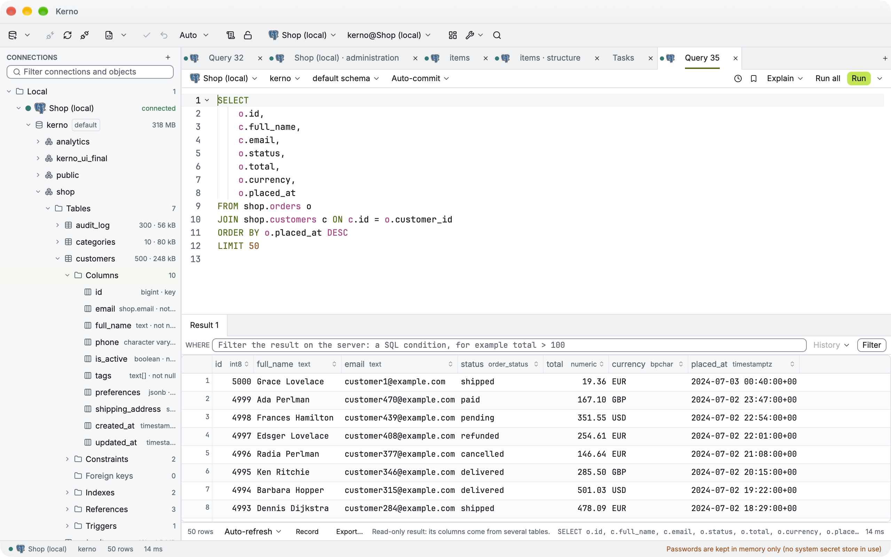
</picture>

Kerno는 바로 열리고 계속 빠르게 반응하는 데이터베이스 클라이언트입니다. 창 안에 띄운 웹 페이지가 아니라
네이티브 앱입니다. DBeaver만큼 폭넓은 기능(스키마 트리, SQL 편집기, 데이터 편집, 구조 편집기, 백업,
관리)을 차분한 인터페이스에 담았으며, 라이트 테마와 다크 테마를 모두 제공합니다.

| | |
|---|---|
| **0.3 s 만에 시작** | 실행부터 사용 가능한 창이 뜨기까지 264 ms |
| **가벼운 메모리 사용** | 연결 하나와 쿼리 탭 하나를 연 상태에서 메모리 약 150 MB |
| **100만 행 스크롤** | 화면의 최대 주사율 그대로 (120 Hz 디스플레이에서 프레임당 8.4 ms) |
| **행을 즉시 표시** | 서버가 전송을 시작한 뒤 3~6 ms 만에 첫 행 표시 |
| **모든 쿼리 취소 가능** | 결과가 페이지 단위로 도착하므로 메모리는 보고 있는 만큼만 사용 |
| **아무것도 컴퓨터 밖으로 나가지 않음** | 원격 측정, 분석, 크래시 업로드 없음 |

Apple M3 Pro에서 측정했습니다. 측정 방법과 모든 수치는 [docs/BENCH.md](docs/BENCH.md)(영문)에 있습니다.

## 목차

- [설치](#설치)
- [시작하기](#시작하기)
- [둘러보기](#둘러보기)
- [개인정보 보호](#개인정보-보호)
- [성능](#성능)
- [문서](#문서)
- [소스에서 빌드하기](#소스에서-빌드하기)
- [현황](#현황)
- [라이선스](#라이선스)

## 설치

[최신 릴리스](https://github.com/EvanPluchart/kerno/releases/latest)에서 사용하는 시스템에 맞는 파일을
내려받습니다. 릴리스에 포함된 `SHA256SUMS`에 각 파일의 체크섬이 나와 있습니다.

### macOS (Apple Silicon)

1. `Kerno-<version>-macos-arm64.dmg`를 열고 Kerno를 Applications 폴더로 끌어다 놓습니다.
2. 처음 실행하면 macOS가 앱을 확인할 수 없다고 알립니다. 이 빌드가 Apple의 공증(notarization)을 받지 않았기
   때문입니다. System Settings ▸ Privacy & Security(시스템 설정 ▸ 개인정보 보호 및 보안)를 열고
   **Open Anyway**(그래도 열기)를 클릭합니다. 터미널에서는 다음 명령을 실행합니다:
   `xattr -dr com.apple.quarantine /Applications/Kerno.app`.

### Linux (x86_64 및 arm64)

| 패키지 | 설치 |
|---|---|
| `kerno_<version>_amd64.deb`, `kerno_<version>_arm64.deb` | `sudo apt install ./kerno_<version>_amd64.deb` (Debian, Ubuntu 및 그 파생 배포판) |
| `kerno-<version>-linux-x86_64.tar.gz`, `…-aarch64.tar.gz` | `tar -xzf kerno-<version>-linux-x86_64.tar.gz -C ~/.local --strip-components=1` 후 `~/.local/bin/kerno` 실행 |
| `Kerno-<version>-x86_64.AppImage`, `…-aarch64.AppImage` | `chmod +x Kerno-<version>-x86_64.AppImage` 후 실행 |

이 패키지는 **glibc 2.31 이상**을 갖춘 모든 배포판(Ubuntu 20.04, Debian 11 이후)에서 실행됩니다. 필요한
라이브러리와 AppImage의 옵션은 [가이드](docs/GUIDE.md#linux)(영문)에 있습니다.

Windows 빌드는 없습니다.

## 시작하기

1. **연결 추가**: <kbd>Cmd</kbd>+<kbd>N</kbd> 키(Linux에서는 <kbd>Ctrl</kbd>+<kbd>N</kbd>)를 누르고 엔진을
   고른 뒤 호스트, 사용자, 비밀번호를 입력하고 **Test connection**, **Save and connect**를 차례로 누릅니다.
   URL을 붙여 넣거나, URL을 넘겨 Kerno를 시작할 수도 있습니다: `kerno postgres://ada@db.example.com:5432/shop`.
2. **탐색**: 사이드바에서 연결을 엽니다. 테이블을 더블클릭하면 그 테이블의 행이 열립니다.
3. **쿼리**: <kbd>Cmd</kbd>+<kbd>T</kbd> 키를 누르면 쿼리 탭이 열리고, <kbd>Cmd</kbd>+<kbd>Enter</kbd> 키를
   누르면 커서 위치의 구문이 실행되며, <kbd>Cmd</kbd>+<kbd>.</kbd> 키를 누르면 실행이 취소됩니다.
4. **무엇이든 찾기**: <kbd>Cmd</kbd>+<kbd>K</kbd> 키를 누르면 명령 팔레트가 열리며, 모든 동작이 단축키와
   함께 나열됩니다.

## 둘러보기

### 접근할 수 있는 곳이라면 어디든 연결

<picture>
  <source media="(prefers-color-scheme: dark)" srcset="docs/screenshots/final/v11-ssh-openssh-dark.png">
  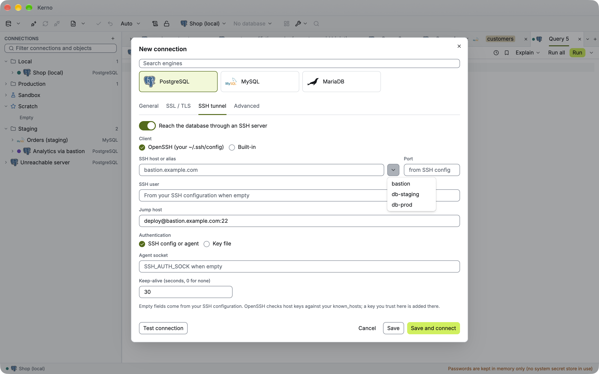
</picture>

- SSL/TLS를 모든 모드로 지원하며, 사용자의 인증서를 쓸 수 있습니다.
- 사용자가 쓰는 OpenSSH를 통해 SSH 터널을 엽니다. `~/.ssh/config`의 호스트, 점프 호스트와 배스천 체인,
  1Password 같은 SSH 에이전트, 모든 키 유형을 사용할 수 있습니다. 비밀번호 로그인은 내장 클라이언트가 처리합니다.
- 비밀번호는 암호화되어 Kerno 자체 파일이나 시스템 키체인 중 선택한 곳에 저장됩니다. 명령, AWS RDS IAM,
  1Password, `~/.pgpass`, `~/.my.cnf`에서 가져올 수도 있습니다.
- 연결에 실패하면 Kerno는 먼저 무슨 일이 일어났는지(호스트를 찾을 수 없음, 연결 거부, 잘못된 비밀번호,
  TLS 실패)와 무엇을 시도하면 되는지를 쉬운 말로 알려 주고, 그다음 서버가 보낸 메시지를 그대로 보여 줍니다.

### 모든 것을 하나의 트리로

<picture>
  <source media="(prefers-color-scheme: dark)" srcset="docs/screenshots/final/navigator-dark.png">
  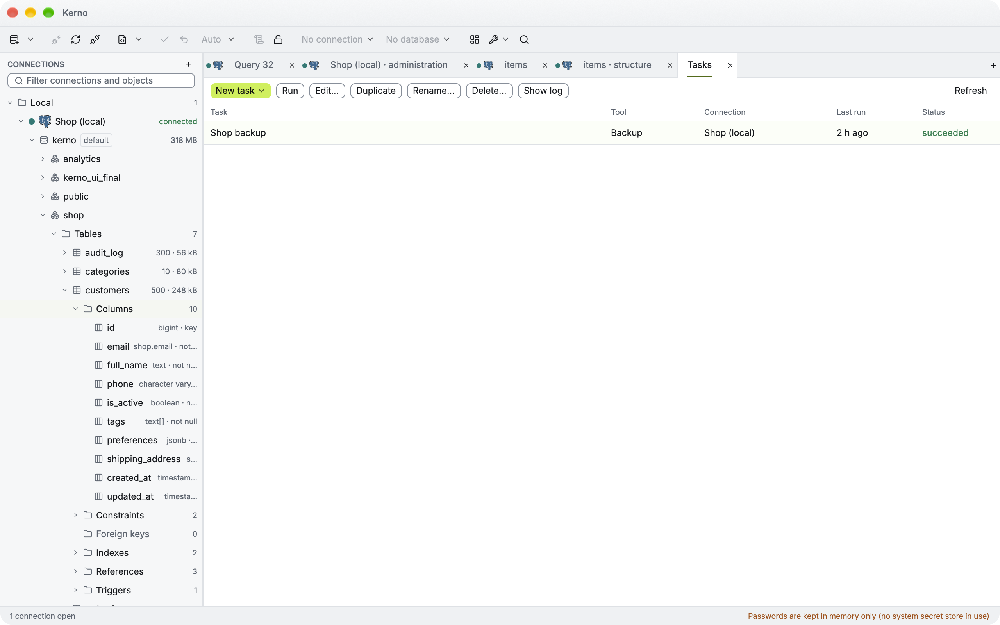
</picture>

폴더와 연결이 트리의 최상위 항목입니다. 연결을 열면 데이터베이스, 스키마, 테이블, 뷰, 함수 등이 표시되며,
각 항목은 펼칠 때 불러옵니다. 폴더마다 색과 아이콘이 있습니다. 모든 행에서 오른쪽 클릭 메뉴를 쓸 수
있습니다. 데이터 열기, 구조 열기, SQL 생성, 이름 바꾸기, 삭제, 백업 등이 들어 있습니다.

### SQL 작성

<picture>
  <source media="(prefers-color-scheme: dark)" srcset="docs/screenshots/final/explain-plan-dark.png">
  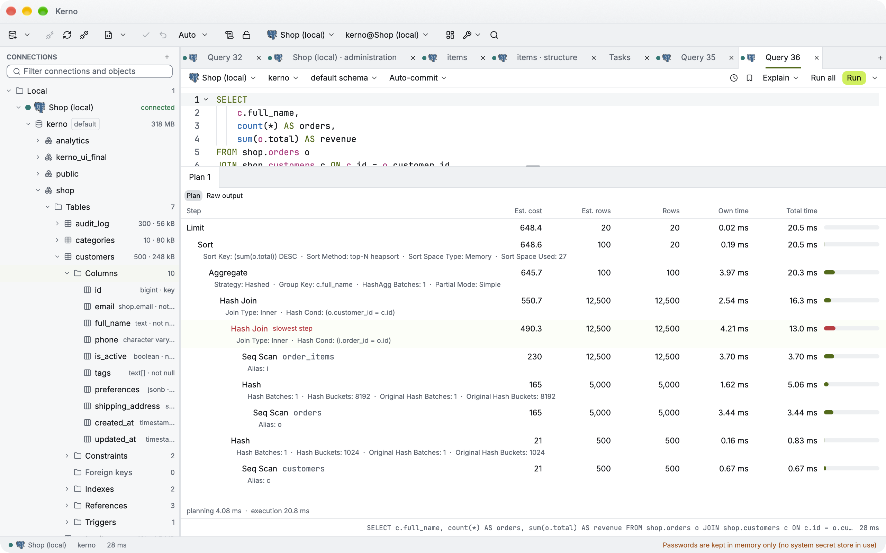
</picture>

- 스키마, 테이블, 열, 외래 키를 아는 자동 완성을 제공합니다.
- 커서 위치의 구문, 선택 영역, 또는 스크립트 전체를 실행합니다. 결과는 구문마다 하나씩 나오며, 탭으로
  나누거나 한 패널에 쌓아서 볼 수 있습니다.
- EXPLAIN과 EXPLAIN ANALYZE 결과를 읽기 쉬운 트리로 보여 주며, 가장 느린 단계를 표시합니다.
- 탭별 트랜잭션, 쿼리 기록, 저장된 쿼리, 매개변수, 포매터, 찾기 및 바꾸기, 다중 커서, 선택해서 켜는 vim
  모드를 지원합니다.
- 하나의 스크립트를 여러 연결에서 동시에 실행할 수 있으며, 각 연결에는 그 연결의 규칙이 적용됩니다.

### 크기와 관계없이 결과 읽기

<picture>
  <source media="(prefers-color-scheme: dark)" srcset="docs/screenshots/final/v11-grid-find-dark.png">
  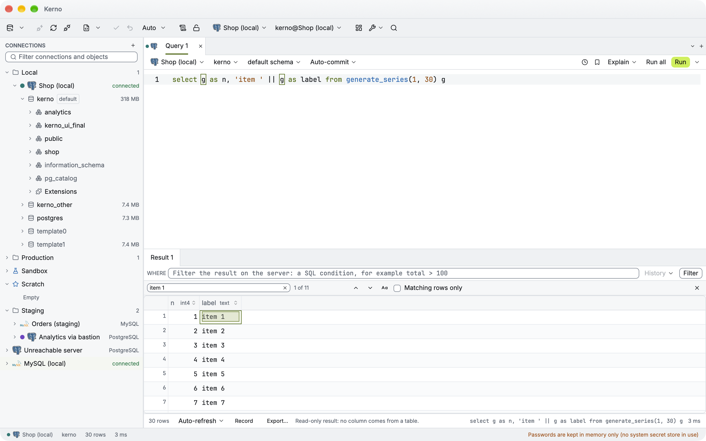
</picture>

결과는 스트리밍으로 들어오고 화면에 보이는 부분만 그리므로, 100만 행도 부드럽게 스크롤됩니다. 가져온
행에서 값을 찾고, 정렬하고, 열을 숨기거나 고정할 수 있으며, 긴 텍스트, JSON, 바이너리 값은 뷰어에서 볼 수
있습니다. CSV, JSON, Markdown, SQL 형식으로 복사하고, CSV, JSON, SQL, Markdown, Excel로 내보낼 수 있습니다.

### 뜻밖의 일 없는 데이터 편집

<picture>
  <source media="(prefers-color-scheme: dark)" srcset="docs/screenshots/final/table-data-pending-edits-dark.png">
  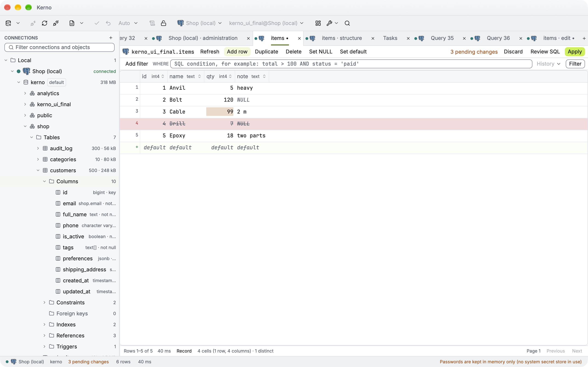
</picture>

셀을 그 자리에서 편집하고, 행을 추가, 복제, 삭제할 수 있습니다. 요청하기 전까지는 아무것도 기록되지
않습니다. 보류 중인 변경 사항은 강조 표시되고, **Review SQL**은 실행될 구문을 정확히 보여 주며, **Apply**는
그 구문을 하나의 트랜잭션으로 실행합니다. 하나라도 실패하면 모두 롤백되고 편집 내용은 그대로 남습니다.
값으로 `now()` 같은 SQL 표현식을 쓸 수도 있습니다.

### 테이블 설계

<picture>
  <source media="(prefers-color-scheme: dark)" srcset="docs/screenshots/final/structure-editor-dark.png">
  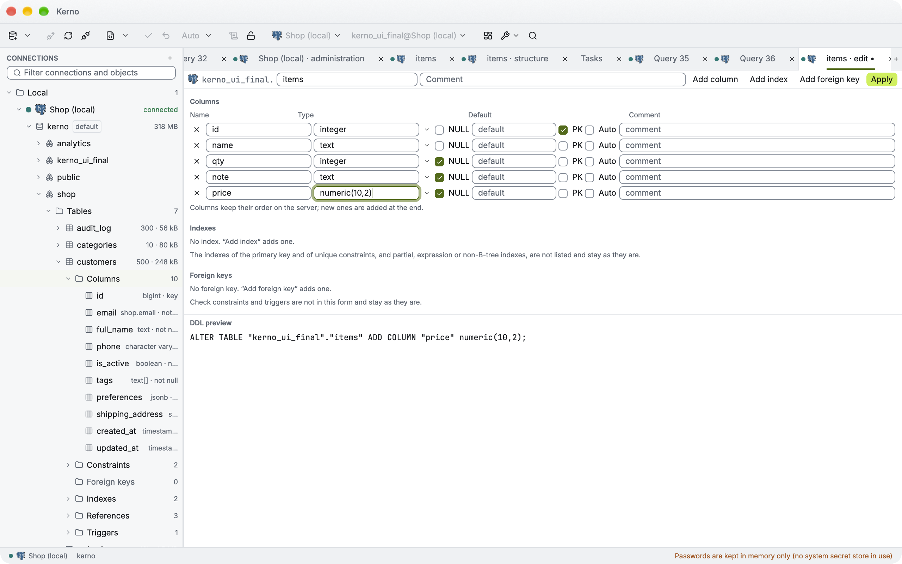
</picture>

폼에서 테이블을 만들고 변경할 수 있으며(열, 인덱스, 외래 키, 주석), SQL을 실시간으로 미리 볼 수 있습니다.
변경 사항은 사용자가 확인한 뒤에 적용됩니다. 뷰, 함수, 프로시저는 편집할 수 있는 소스로 열립니다.

### 테이블 간 관계 보기

<picture>
  <source media="(prefers-color-scheme: dark)" srcset="docs/screenshots/final/v11-er-diagram-dark.png">
  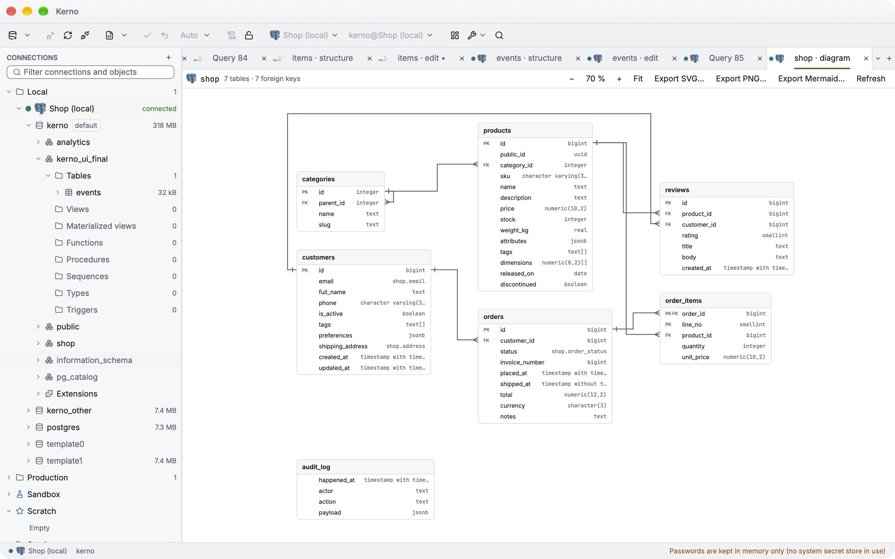
</picture>

스키마 전체, 또는 한 테이블과 그 이웃 테이블의 ER 다이어그램을 외래 키를 바탕으로 그립니다. 화면 이동과
확대/축소가 가능하고, 더블클릭으로 테이블을 열 수 있으며, SVG, PNG, Mermaid로 내보낼 수 있습니다.

### 프로덕션은 안전하게

<picture>
  <source media="(prefers-color-scheme: dark)" srcset="docs/screenshots/final/chrome-production-dark.png">
  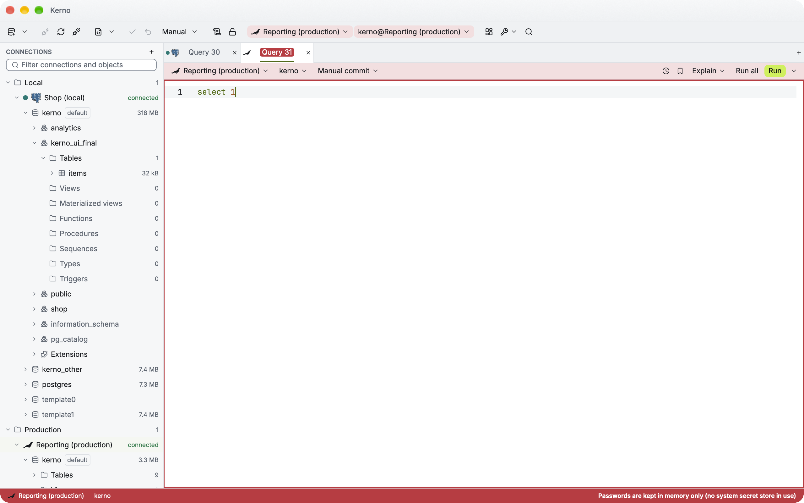
</picture>

각 연결에는 환경(local, staging, production 또는 직접 만든 환경)이 있습니다. 환경에는 연결이 활성 상태인
동안 창에 입혀지는 색과 규칙이 있습니다. 파괴적인 구문은 항상 SQL을 보여 주고 먼저 확인을 받으며,
production에서는 모든 쓰기 작업에 대해 한 번 더 확인합니다. 연결을 앱과 서버 양쪽에서 읽기 전용으로 설정할
수 있습니다.

### 데이터 옮기기

<picture>
  <source media="(prefers-color-scheme: dark)" srcset="docs/screenshots/final/v11-transfer-mapping-dark.png">
  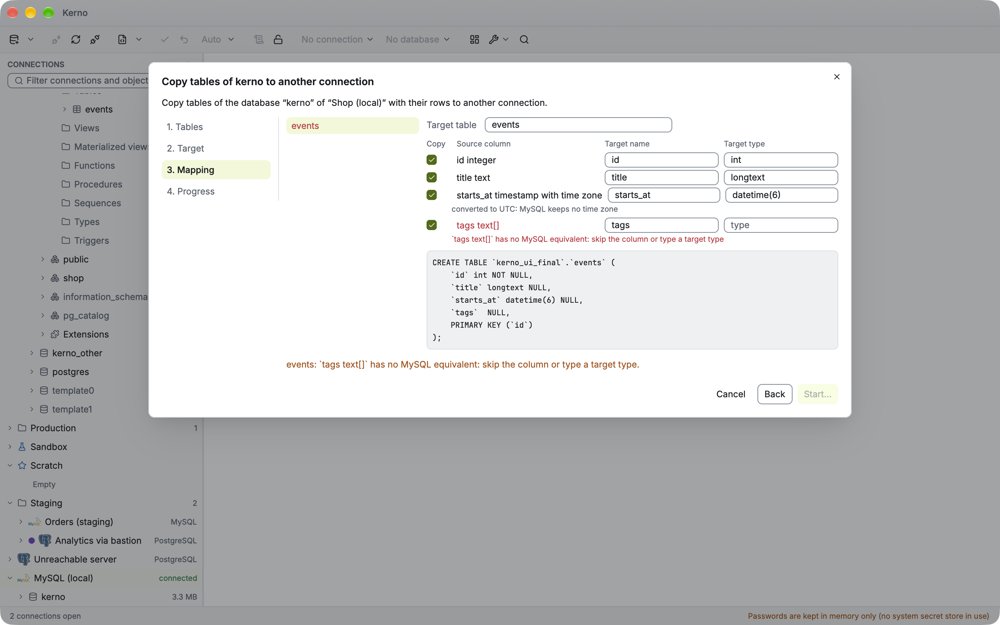
</picture>

- 테이블을 행과 함께 다른 연결로 복사할 수 있습니다. PostgreSQL, MySQL, MariaDB 사이에서 어느 방향으로든
  가능하며, 각 열의 타입이 표시되고 수정할 수 있습니다.
- `pg_dump`, `pg_restore`, `psql`, `mysqldump`, `mysql`을 이용한 백업과 복원을 단계별 마법사로 제공하며,
  이 마법사는 작업(task)으로 저장할 수 있습니다.
- CSV를 새 테이블이나 기존 테이블로 가져올 수 있습니다.
- 연결, 폴더, 설정을 비밀번호가 들어 있지 않은 파일로 내보내고, 다른 곳에서 가져올 수 있습니다.

### 원할 때만 쓰는 AI 어시스턴트

<picture>
  <source media="(prefers-color-scheme: dark)" srcset="docs/screenshots/final/v11-ai-write-sql-dark.png">
  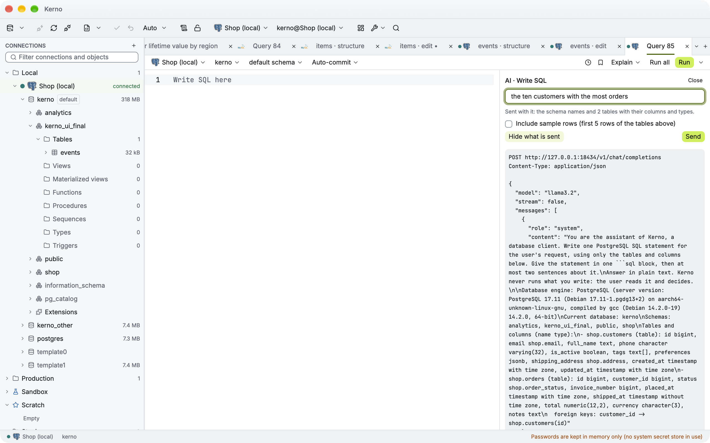
</picture>

사용자가 켜기 전까지는 꺼져 있습니다. 사용자가 선택한 엔드포인트, 우선은 로컬 모델(Ollama, LM Studio)과
통신하며, Send를 클릭할 때만 요청을 보냅니다. 문장으로 SQL을 작성하고, 쿼리, 실행 계획, 오류를 설명할 수
있습니다. 테이블과 열의 이름을 보내며, 해당 요청에서 확인란을 선택하지 않는 한 행 데이터는 보내지 않습니다.
또한 보내기 전에 전송할 내용을 정확히 보여 줍니다. 어떤 것도 직접 실행하지 않으며, 사용자가 읽고 실행할 수
있도록 SQL을 삽입할 뿐입니다.

### 그 밖의 기능

관리 뷰(세션, 잠금, 역할, 크기, 설정), 명령 팔레트, 메인 도구 모음, 세 가지 탭 레이아웃, 키맵 파일, 셸에서
실행하는 `kerno <url>`도 있습니다. 각 항목을 검증하는 테스트까지 포함한 전체 목록은
[docs/FEATURES.md](docs/FEATURES.md)(영문)에 있습니다.

## 개인정보 보호

Kerno는 사용자나 사용자의 데이터에 관한 어떤 정보도 보내지 않습니다. 데이터베이스 연결 외에는 두 종류의
요청을 보냅니다.

- **업데이트 확인.** 실행할 때와 6시간마다 이 저장소의 릴리스 페이지에 요청을 한 번 보내며, 식별자는
  포함하지 않습니다. 더 새로운 버전이 있으면 그 릴리스 노트를 읽는 요청을 한 번 더 보냅니다. Settings ▸ Updates에서 끄거나 `KERNO_NO_UPDATE_CHECK=1`로 끌 수 있습니다.
- **AI 어시스턴트**는 사용자가 켠 뒤에만, 사용자가 설정한 엔드포인트로만, 사용자가 요청할 때만 요청을 보냅니다.

비밀번호, SSH 패스프레이즈, API 키는 평문으로 기록되지 않으며 로그에도 남지 않습니다. macOS에서는 기본적으로
Kerno 데이터 폴더의 암호화된 자체 파일에 보관되고, 키는 그 옆의 두 번째 파일에 있습니다. 비밀번호를 묻는 창이
없고 파일 사본만으로는 아무것도 보이지 않지만, 사용자 계정으로 실행되는 프로그램은 두 파일을 모두 읽을 수
있습니다(DBeaver나 `~/.pgpass`와 같은 수준). Settings ▸ Passwords에서 macOS Keychain을 고를 수도 있습니다.
Kerno 빌드는 Apple Developer ID로 서명되지 않으므로, 이 경우 업데이트할 때마다 Keychain이 로그인 비밀번호를
다시 묻습니다. Linux에서는 기본적으로 Secret Service에 보관됩니다. 자세한 내용은
[가이드](docs/GUIDE.md#where-passwords-are-kept)에 있습니다.

## 성능

Apple M3 Pro에서 릴리스 빌드와 로컬 서버로 측정한 중앙값입니다.

| 항목 | 결과 |
|---|---|
| 콜드 스타트부터 사용 가능한 창까지 | 264 ms |
| 유휴 상태 메모리 (연결 1개, 쿼리 탭 1개) | 150 MB |
| 서버가 전송을 시작한 뒤 첫 행이 화면에 표시되기까지 | 3~6 ms |
| 1,000,000행 스크롤 | 프레임당 8.4 ms (120 Hz) |
| 1,000,000행 × 20열 전체 가져오기 | 340 MB (셀당 17바이트) |
| 300열 테이블 스크롤 | 프레임당 8.3 ms |
| 테이블 1,200개짜리 스키마 열기 | 103 ms |
| 200 MB `.sql` 파일 실행 | 17.7 s, 창은 계속 반응함, 0.1 s 만에 취소 |
| 서버가 복구된 뒤 다시 사용 가능해지기까지 | 1.0 s |

측정 방법, 범위, 재현 방법은 [docs/BENCH.md](docs/BENCH.md)에 있습니다.

## 문서

- [가이드](docs/GUIDE.md): SSH, 비밀번호 출처, AI 어시스턴트와 전송 내용, vim 모드, 업데이트, 키보드 단축키와
  키맵 파일.
- [기능](docs/FEATURES.md): 동작하는 모든 기능과 그 테스트 및 스크린샷.
- [벤치마크](docs/BENCH.md), [아키텍처](docs/ARCHITECTURE.md)(영문), [로드맵](docs/ROADMAP.md)(영문),
  [결정 기록](docs/DECISIONS.md)(영문).
- [기여 안내](CONTRIBUTING.md)(영문).

## 소스에서 빌드하기

Rust(툴체인은 `rust-toolchain.toml`에 고정되어 있으며 rustup이 설치합니다)와, macOS에서는 Xcode 명령줄 도구가
필요합니다.

```sh
cargo build --release -p kerno
cargo run --release -p kerno
```

Debian이나 Ubuntu에서는 먼저 `sudo scripts/install-linux-deps.sh`로 시스템 라이브러리를 설치합니다. 패키징,
로컬 검사, 테스트 데이터베이스는 [가이드](docs/GUIDE.md#build-from-source)에 설명되어 있습니다.

## 현황

버전 2026.11.2입니다. macOS(Apple Silicon)와 Linux(x86_64, arm64)에서 PostgreSQL, MySQL, MariaDB, SQLite를
지원합니다. 다른 엔진, 데이터 비교 등은 [로드맵](docs/ROADMAP.md)에 있습니다.

## 라이선스

MIT OR Apache-2.0이며, 둘 중 원하는 쪽을 선택할 수 있습니다: [LICENSE-MIT](LICENSE-MIT)(영문),
[LICENSE-APACHE](LICENSE-APACHE)(영문). DBeaver와 엔진 로고를 포함한 서드파티 고지는
[THIRD_PARTY_NOTICES.md](THIRD_PARTY_NOTICES.md)(영문)에 있습니다.
