<p align="center">
  <picture>
    <source media="(prefers-color-scheme: dark)" srcset="assets/brand/kerno-horizontal-reversed.svg">
    
  </picture>
</p>

Kerno is a native, open-source database client for macOS and Linux, written in Rust with GPUI. All database,
file, SSH and secret-store work runs off the UI thread, results stream in pages and are drawn virtually, and
every running query can be cancelled. There is no telemetry, no analytics and no crash upload. The one request
Kerno makes on its own is the update check: at launch and every 6 hours it sends a `HEAD` request to
`https://github.com/EvanPluchart/kerno/releases/latest` through the system's `curl`, with the redirect not
followed, a `Kerno/<version>` user agent, no cookie, no identifier and nothing else, and reads the version in the
redirect. It offers only a strictly newer `X.Y.Z` and says nothing when offline. Turn it off in
Settings ▸ Updates, or for a run with `KERNO_NO_UPDATE_CHECK=1`; Help ▸ Check for Updates… asks only when you
click it. An update is installed only after its SHA-256 matches the release's `SHA256SUMS`; the
[architecture notes](docs/ARCHITECTURE.md#the-update-check) give the details. The AI assistant is off
until you turn it on, and then talks only to the endpoint you configure, only when you ask: see
[AI assistant and what it sends](#ai-assistant-and-what-it-sends).

Version 1 connects to PostgreSQL, MySQL and MariaDB. Its feature set and interactions follow DBeaver
Community; its look follows the calm, dense style of modern editors. Licensed under MIT OR Apache-2.0.

## Screenshots

| Dark | Light |
| ---- | ----- |
| 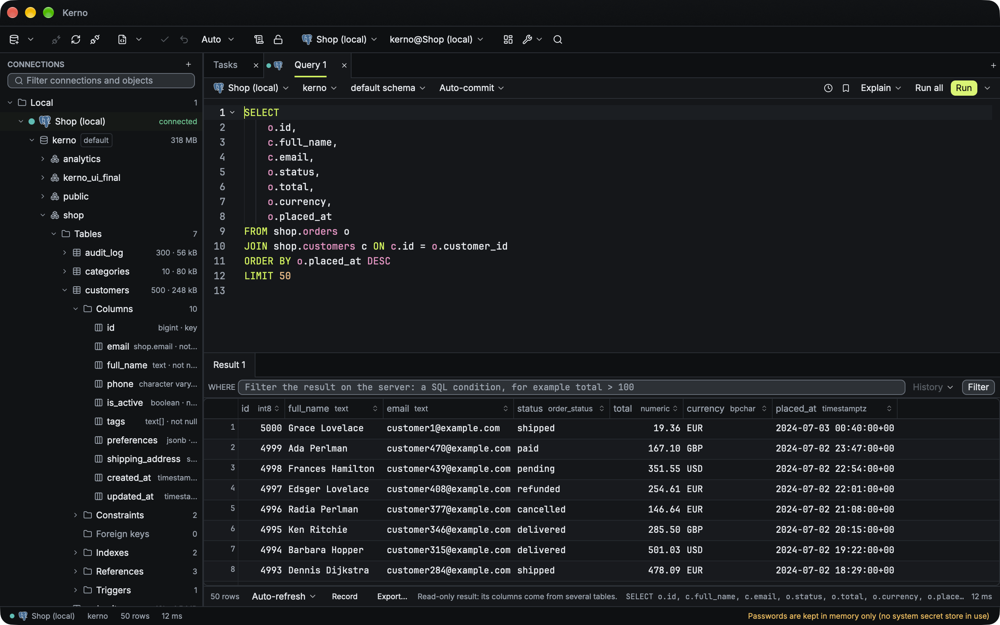 | 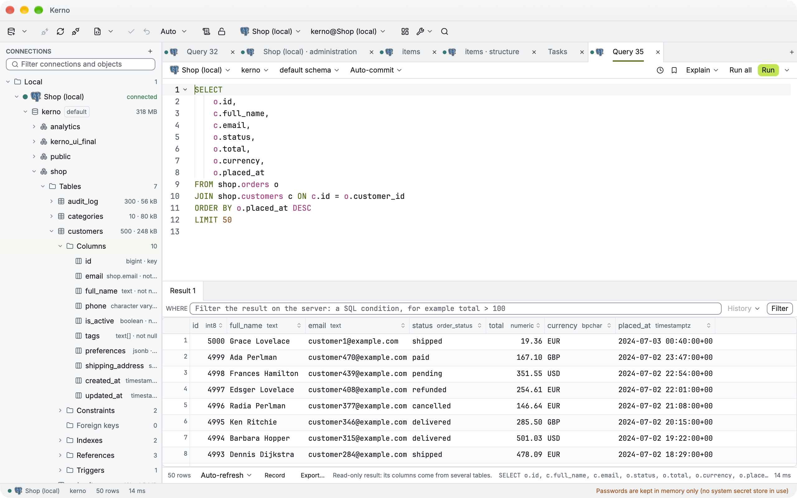 |
| 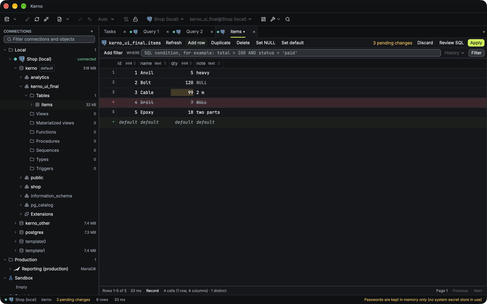 | 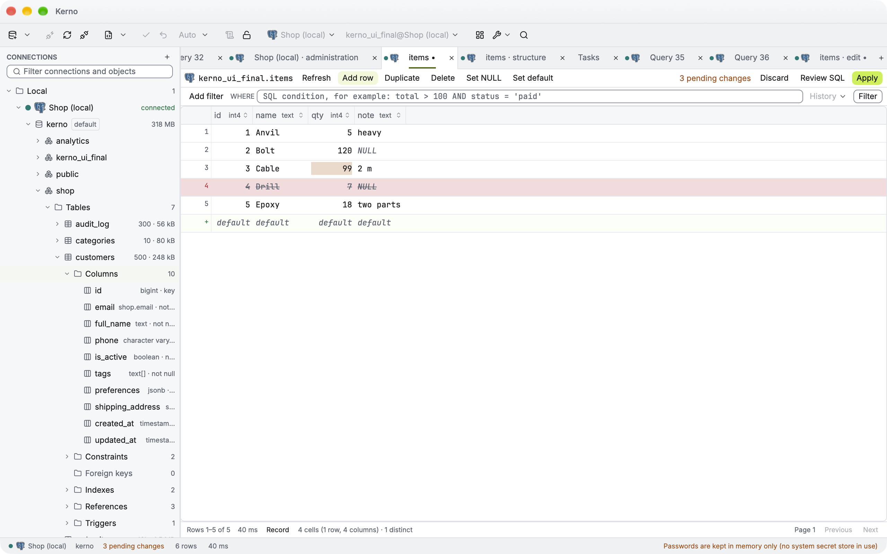 |
| 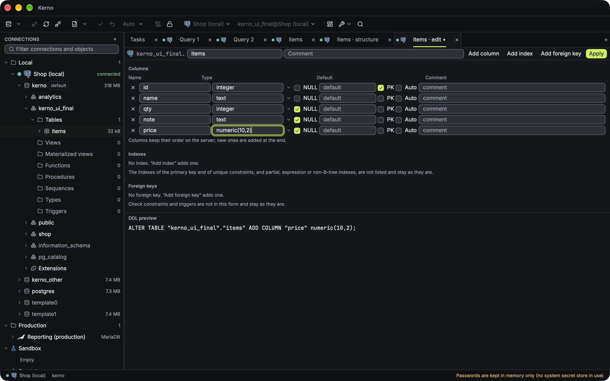 |  |
| 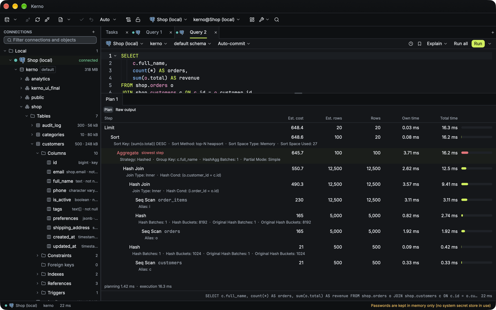 | 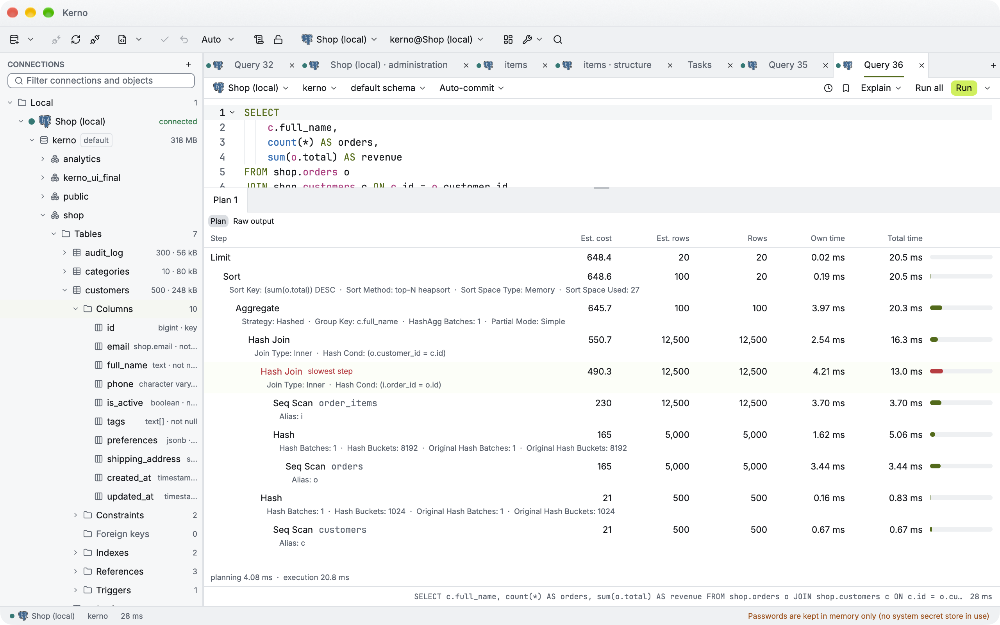 |
| 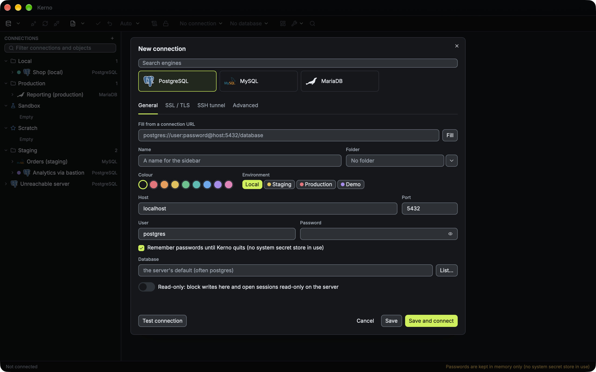 | 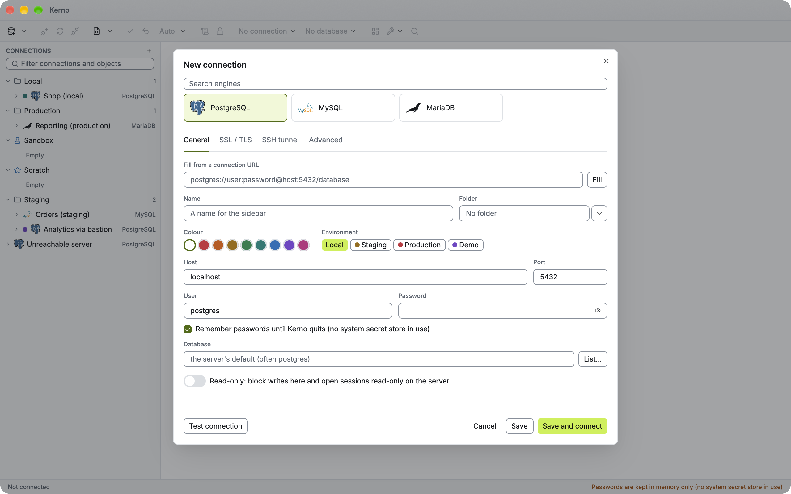 |
| 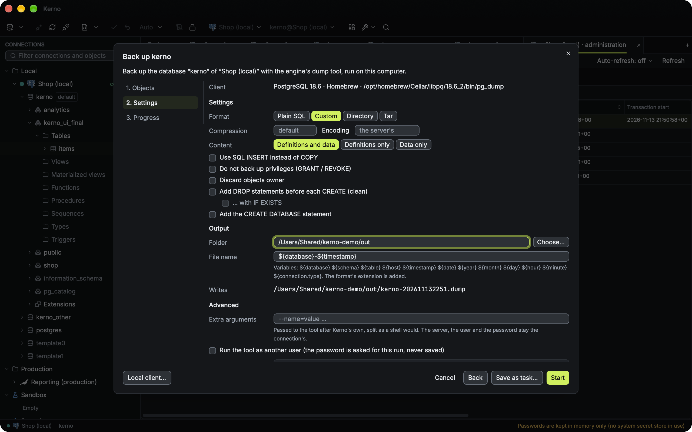 | 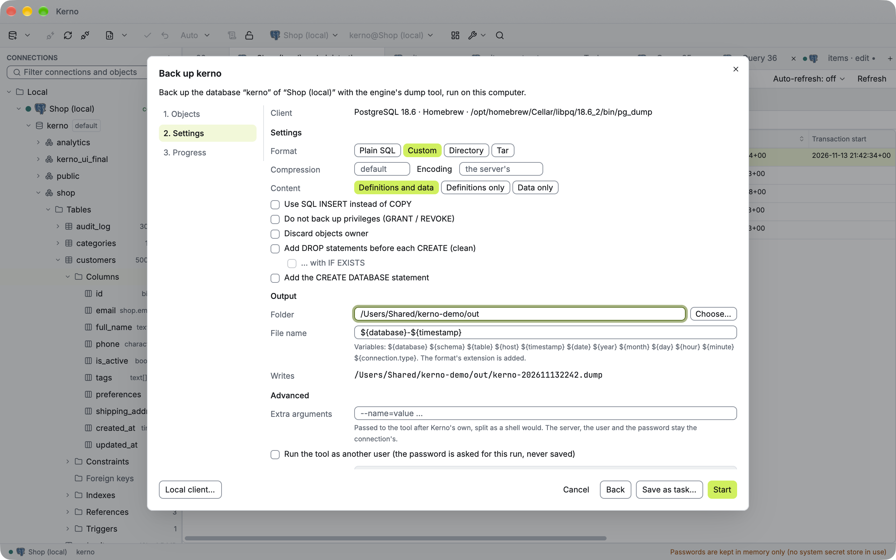 |
| 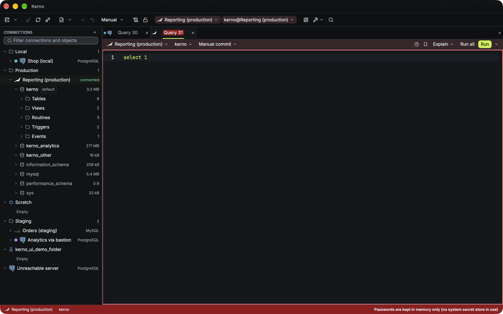 | 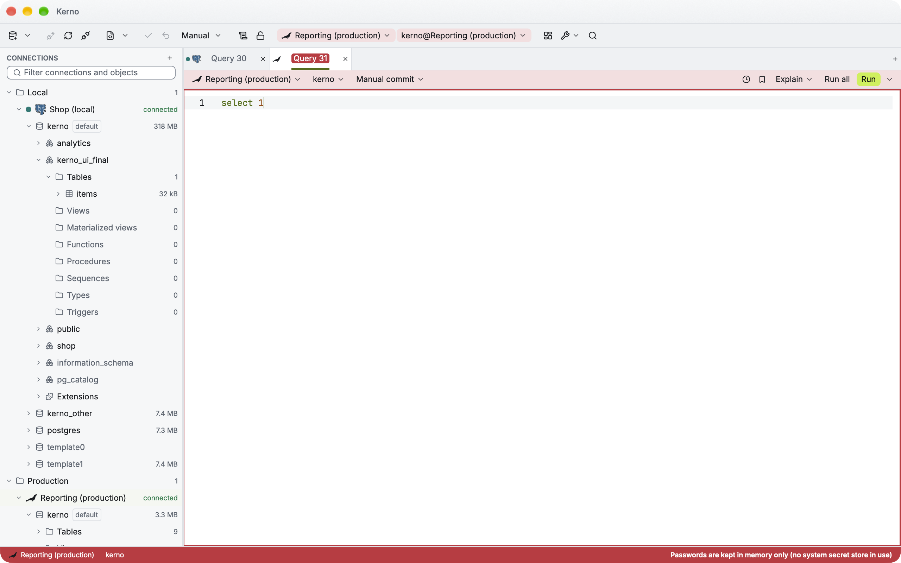 |

## What it does

The list of what works, with the tests that cover it, is [docs/FEATURES.md](docs/FEATURES.md). In short:

- Connections with SSL/TLS modes, SSH tunnels and a read-only flag; passwords live in the OS secret store and
  are read from it once per run. A connection that fails says what happened in plain words first (host not
  found, connection refused, timed out, wrong password, TLS failure) with the next step, and shows the server's
  own message below.
- One tree in the sidebar, as DBeaver's Database Navigator: folders and connections are the roots, and opening a
  connection connects it and shows its databases (the default one first), schemas and objects under it. Folders
  have a colour and an icon (a built-in glyph or a PNG, JPEG or SVG you pick); connections move between folders
  by drag and drop. Every surface answers a right-click.
- Environments as DBeaver's connection types: local, staging and production, which can be edited, and your own.
  Each has a colour that tints the window's chrome while its connection is active, and rules: auto-commit by
  default, confirm every execution, read-only by default, idle transactions rolled back.
- A main toolbar under the title bar, as DBeaver's: new connection (by engine), connect, reconnect,
  disconnect, new SQL editor (with the recent scripts), commit, rollback, the transaction mode with the
  isolation level, the transaction log, read-only, the active connection and `schema@connection`, the
  dashboard, the connection's tools and Open table. Right-click it to hide items; View ▸ Show Main Toolbar
  hides it.
- A lazy schema navigator, a SQL editor with schema-aware completion, a streamed results grid, EXPLAIN as a
  plan tree, per-tab transactions, query history and saved queries.
- Run script on connections… (editor menu, Run menu, palette, Query menu): tick connections or whole folders,
  and the script runs in a tab of its own on each, at most four at a time, under each connection's own rules
  (read-only refuses the writes, production asks first); a summary lists each one's outcome.
- A table data view with inline editing, SQL review and one-transaction apply; structure views and a form
  editor for tables.
- Exports to CSV, TSV, JSON, NDJSON, SQL INSERT, Markdown and Excel (XLSX: numbers, booleans and dates as
  typed cells, a new sheet every 1,048,575 rows), streamed to disk with progress and cancel; CSV import, and a
  Tools submenu on databases, schemas and tables: backup, global
  backup, restore and execute script as step wizards on the installed client tools (`pg_dump`, `pg_dumpall`,
  `pg_restore`, `psql`, `mysqldump`, `mysql`), analyze, vacuum, optimize, check and repair, foreign data
  wrappers, the session and lock managers. A wizard's settings can be saved as a named task and run again from the
  Tasks view (there is no scheduler). Settings ▸ Local clients lists every client install it finds, with its
  version, and lets you add a folder and choose the default per engine; a connection can use its own.
- An administration view (sessions, roles, sizes, settings).
- An ER diagram of a schema (a MySQL database), or of a table and the tables linked to it ("View diagram" in
  the tree, "Diagram" in a table's structure, View ER Diagram in the palette): tables with their PK and FK
  marks, one edge per foreign key, pan, zoom, fit, drag a table aside; a double click opens its data. Exports
  to SVG, PNG and Mermaid. Read-only.
- Copy tables with their rows to another connection, PostgreSQL, MySQL or MariaDB in any direction (Tools ▸
  Copy tables to another connection…): the tables are created or appended to, each column's type mapped and
  editable, what has no counterpart refused until skipped or typed, the SQL shown and confirmed, the rows
  written in batches with progress, cancel and a report.

Measurements: [docs/BENCH.md](docs/BENCH.md).

## SSH

A connection reaches its database through an SSH server with one of two clients, chosen on the SSH tab.
**OpenSSH**, the default when `ssh` is installed, runs your own `ssh`, so everything in `~/.ssh/config` applies:
`Host` aliases (the host field lists them), `ProxyJump` and the Jump host field (`ssh -J`, several hosts
separated by commas), IdentityAgent (1Password, Secretive), RSA and every other key type, and OpenSSH's
known_hosts; port, user and key may be left empty for the configuration to give them. It forwards a private
Unix socket, never a TCP port. A key's passphrase is asked for and kept in the secret store, never on the
command line; a server key you choose to trust is added to your known_hosts. `KERNO_SSH_CONFIG=<file>` makes
Kerno pass another configuration file to `ssh` (`-F`). The **built-in** client needs no `ssh` and is the one for
a password login; it takes Ed25519 and ECDSA key files and the keys of an SSH agent, not RSA key files.

## Passwords from a command, AWS RDS IAM, 1Password, .pgpass and .my.cnf

The connection dialog's **Password from** list says where the database password comes from. **Keychain**
(the default) keeps it in the system secret store; left empty, Kerno reads `~/.pgpass` (or `PGPASSFILE`) for
PostgreSQL and the `password` of the `[client]` group of `~/.my.cnf` for MySQL and MariaDB, as their own tools
do (`!include` lines of `.my.cnf` are not followed). A `.pgpass` that other users can read, or a `.my.cnf`
anyone can change, is ignored, and the error says so. **Ask each time** asks at every connect. **Command**
runs a program of yours and uses what it prints (one trailing newline removed): no shell, one argument per
line, `${host}`, `${port}`, `${user}` and `${database}` replaced inside the arguments, at most 120 s.
**AWS RDS IAM** runs `aws rds generate-db-auth-token` with the connection's host, port and user, your region
and optional profile, and needs TLS (the SSL mode moves to `require`). **1Password** runs `op read
op://vault/item/field`. A command's output is used for that connect only, never stored or logged, and runs
again for new sessions after ten minutes (an RDS token lasts fifteen); "Run now" checks it and shows only the
length of what it printed. Programs are found on your `PATH` and in `/opt/homebrew/bin`, `/usr/local/bin`,
`/usr/bin` and `/bin`. A test or a connection says where its password came from ("Password from ~/.pgpass").
An exported connections file carries the command but no password; on import a command does not run until you
have read it in the connection's settings and clicked "I trust this command".

## Open a connection from the shell

`kerno postgres://ada@db.example.com:5432/shop` opens that connection (`postgresql://`, `mysql://` and
`mariadb://` too; `sslmode` and other parameters as in the connection dialog). A saved connection to the same
engine, host, port, user and database is used when there is one; otherwise the connection opens **unsaved**:
marked in the sidebar, kept for this run only, its password in memory, never in the keychain, until "Save
connection…" in its menu stores it. When Kerno is already running, the URL opens in its window, which comes to
the front. `kerno --version` and `kerno --help` print and exit.

Leave the password out of the URL: other programs running as your user can read a command line (`ps`). Without
one, Kerno asks for it when the server wants it.

## Move your setup to another computer

**Export Connections…** (File menu, the sidebar's menu, the palette) writes a JSON file with what you tick:
the connections (with their ids), the folders' colours and icons, your environments and the built-ins you
edited, and the saved tasks. The environments your connections use always go with them. The file holds no
password, passphrase or key, no local client folder and no folder picture. **Import Connections…** first lists
what the file adds, replaces (same id; same name for a task) or leaves as it is, then asks for each connection
written where its password comes from: **Enter now** (kept in the secret store), **Ask when connecting**, or,
when the secret store already holds secrets under that connection's id, **Use the keychain's saved secrets**
(the database password and the SSH password or key passphrase, all or none), which names where each will be
sent and never shows them. A saved password is linked automatically only to a connection this copy of Kerno
already has, pointing at the same server (SSH tunnel included); otherwise you choose, and a connection left
unlinked cannot read any of the old secrets. Files written by earlier versions still import.

## AI assistant and what it sends

The assistant is off until **Settings → AI ▸ Enable the AI assistant** is ticked. While it is off, no
request is ever made: its entries (editor menu ▸ **AI: Write SQL…**, **Explain query**, **Explain plan**,
**Explain error**, the palette, Query ▸ AI Assistant) say "turn on in Settings → AI" and do nothing.

On, it talks to one OpenAI-compatible endpoint you set (`POST <endpoint>/chat/completions`), and only when
you click **Send**. Local servers come first: Ollama (`http://localhost:11434/v1`) and LM Studio
(`http://localhost:1234/v1`). Plain `http://` is accepted only for this computer (`localhost`, `127.0.0.1`,
`::1`); any other host needs `https://`, and Kerno names it ("Requests will leave this computer and go to
…") and sends nothing there until you click **Allow requests to …** once for that endpoint. Requests never go
through a proxy and never follow a redirect. **List models** asks `GET <endpoint>/models`, only when you click
it. An API key, for the endpoints that want one, is kept in the system's secret store for that endpoint
only; it is sent as `Authorization: Bearer …` and appears nowhere else (previews and the log show
`Bearer ***`).

What a request holds, and nothing more:

- the instruction for the action, and your sentence, the statement (the selection or the one at the
  cursor), the plan on screen, or the statement and the server's error message (which may quote a value:
  the preview shows it before you send);
- the engine, its version and the current database; the names of the schemas; the tables the statement or
  the sentence names (else the tables of the tab's schema): their names, column names and types and foreign
  keys, 200 tables at most with their columns, then names only;
- rows only when you tick **Include sample rows (first 5 rows of the tables above)** for that request (up to
  10 tables); the tick is off again at every new request.

**What is sent…** in the panel shows the exact bytes before you send them; Settings → AI ▸ **What was sent**
lists every request of the session (time, endpoint, body), in memory only. The answer is shown as text:
nothing in it runs or opens anything. **Insert** puts its SQL in the editor (at the cursor, selected, one undo
step; a proposed fix goes after your text as a new statement) and you run it yourself, through the usual
confirmations, read-only and production rules. **Stop** drops an answer you no longer want (the request ends
on its own within its 60 s timeout).

## Vim mode

Off by default. Turn it on with **Settings → Editor ▸ Vim mode** or the command **Toggle Vim Mode** (palette,
Edit menu). While it is off nothing of it runs: the editor behaves exactly as without it.

On, the SQL editors have vim's Normal, Insert, Visual (`v`) and Visual line (`V`) modes. The status bar shows
the mode; in Normal mode the character under the cursor is shaded as a block (the editor's thin caret stays).
What is supported, and nothing more:

- **Motions**, with a count: `h j k l`, `w b e`, `0 ^ $`, `gg` and `G` (with a count, that line), `f{char}`
  and `t{char}` on the line, `%` (the matching bracket; brackets in strings and comments are text), Enter,
  Backspace and Space.
- **Operators**: `d`, `c` and `y` with a motion, with `iw` or `aw`, or on a Visual selection; `dd`, `cc`, `yy`;
  `x`; `p` and `P`; `u` and `Ctrl+R` (undo, redo); `.` repeats the last change, typed text included.
- **Insert**: `i a I A o O` (`o` and `O` keep the line's indentation), `Esc` back to Normal mode.
- **Search**: `/text` then Enter, `n` and `N` (plain text, case-sensitive, wraps around).
- **Commands**: `:w` saves the file, `:q` closes the tab, `:wq` (or `:x`) saves then closes, `:q!` closes
  without keeping unsaved text. `:` and `/` open a one-line field under the editor; Escape closes it.
- **One register, the system clipboard**: `y`, `d` and `c` write it, `p` reads it, so they work with Cmd+C
  and Cmd+V. Lines yanked by vim paste as lines while the clipboard still holds them; text copied elsewhere
  pastes as characters.

In every mode the arrows, Home/End, Page Up/Down, the mouse and every Cmd shortcut (Ctrl on Linux) keep
working: run (Cmd+Enter), save, the palette, find, zoom, completion. In Insert mode every key but Escape is
the editor's, so Tab and Enter still accept a completion. `:q` asks before closing what would be lost, as
Cmd+W does; `:q!` lets go of unsaved text, but an open transaction or pending changes still ask. On Linux,
Ctrl+R is Refresh Rows outside Normal mode.

Not supported: counts on `i a o`, `F T ; ,`, text objects other than `iw` and `aw`, named registers, marks,
macros, `r ~ J > <`, Visual block (`Ctrl+V`) and other `:` commands. The editor records each edit on its own,
so `ciw` followed by typed text is undone in two steps (the deletion, then the typing).

## Install

There is no published release yet. `scripts/bundle-macos.sh` builds `dist/Kerno.app` and a `.dmg`, and
`scripts/bundle-linux.sh` builds the Linux packages (below).

On macOS the bundle is signed ad hoc unless `KERNO_SIGN_IDENTITY` names a code-signing identity of yours
(`KERNO_SIGN_IDENTITY="Apple Development: …" scripts/bundle-macos.sh`). Kerno reads each saved password from
the keychain once per run. An ad-hoc signature changes with every build, so the keychain asks for your login
password again after each rebuild; "Always allow" stops it for that build. A stable identity avoids it, and an update installed by Kerno
keeps the signature of its release: an ad-hoc one makes the keychain ask again once.

### Linux

Each release carries, for x86_64 and arm64 (aarch64):

| Package | Install |
|---|---|
| `kerno_<version>_amd64.deb`, `kerno_<version>_arm64.deb` | `sudo apt install ./kerno_<version>_amd64.deb` (Debian, Ubuntu and their derivatives; apt installs the dependencies) |
| `kerno-<version>-linux-x86_64.tar.gz`, `…-aarch64.tar.gz` | `tar -xzf kerno-<version>-linux-x86_64.tar.gz -C ~/.local --strip-components=1`, then run `~/.local/bin/kerno`. Kerno updates itself in place from this one |
| `Kerno-<version>-x86_64.AppImage`, `…-aarch64.AppImage` | `chmod +x Kerno-<version>-x86_64.AppImage` and run it. It mounts itself through FUSE (the `fusermount3` or `fusermount` program, from the `fuse3` or `fuse` package); without FUSE, run it with `--appimage-extract-and-run` |

The packages run on any distribution with **glibc 2.31 or newer** (Ubuntu 20.04, Debian 11 and later): they are built on Ubuntu 20.04, and each is started there and on Debian 13 before a release
(`scripts/check-linux-packages.sh`). The tarball and the AppImage use the system's libraries, as the `.deb`
does through its dependencies; install them if they are missing (Debian and Ubuntu names):
`sudo apt install libxcb1 libxkbcommon0 libxkbcommon-x11-0 libwayland-client0 libvulkan1`, and a Vulkan driver
(`mesa-vulkan-drivers` or your GPU vendor's). The fonts are built in.

Backup and restore call `pg_dump`, `pg_restore`, `psql`, `mysqldump` and `mysql` when they are installed;
nothing else needs them.

## Build from source

The repository pins its Rust toolchain in `rust-toolchain.toml`; rustup installs it on first use.

macOS: install the Xcode command line tools, then

```sh
nice -n 10 cargo build --release -p kerno
nice -n 10 cargo run --release -p kerno
```

Metal shaders are compiled at runtime, so the Metal toolchain is not required (see D-002 in
[docs/DECISIONS.md](docs/DECISIONS.md)).

Linux (Debian or Ubuntu): install GPUI's native dependencies as root, then build the same way.

```sh
sudo scripts/install-linux-deps.sh
nice -n 10 cargo build --release -p kerno
```

`scripts/bundle-linux.sh` builds the Linux packages inside Docker, from macOS or Linux, on an arm64 host (Apple
Silicon): the image of `packaging/linux/Dockerfile` (Ubuntu 20.04) builds arm64 natively and cross-compiles
x86_64. `KERNO_JOBS` sets cargo's jobs (3 by default). The image `kerno-linux-build` and the volume
`kerno-linux-cache` (cargo registry and build output) stay for the next run; `scripts/bundle-linux.sh --clean`
removes both. `.cargo/config.toml` caps cargo at 3 jobs.

## Checks and releases

There is no hosted CI: the checks run locally. `scripts/check.sh` runs `cargo fmt --check`, clippy with
`-D warnings`, `cargo deny check` and the workspace tests (starting the `kerno-*` containers if they are not
running, and stopping them again if it started them), one summary line per step, stopping at the first
failure. `scripts/check.sh --no-tests` skips the tests. It refuses to start when the machine is busy.

A release is built locally with `scripts/release.sh [version]`: it checks the tree is clean and the version
matches `Cargo.toml`, builds the macOS `.dmg` (on macOS) and the Linux packages, starts each Linux package in
clean containers (`scripts/check-linux-packages.sh`), and writes `dist/SHA256SUMS`.
`scripts/release.sh --linux-only` builds and checks the Linux packages alone, on a tree that may be dirty.
It then prints the `gh release create` command; the owner runs it. The script creates no tag, pushes and
uploads nothing; its only downloads are the Docker base images and pinned build tools of the Linux build.

## Test databases

The integration tests run against containers named `kerno-*`: PostgreSQL 17 (host port 55432), MySQL 8.4
(53306), MariaDB 11 (53307), an SSH server (52222) and a jump host in front of it (52223), all bound to
127.0.0.1 with test-only credentials.

```sh
scripts/test-env.sh up        # generate test certificates and keys, start, wait until seeded
nice -n 10 cargo test --workspace -- --test-threads=3
scripts/test-env.sh down      # stop and remove the containers
```

Tests skip with a message when a container is down; `KERNO_REQUIRE_CONTAINERS=1` makes that a failure.
Details in [CONTRIBUTING.md](CONTRIBUTING.md).

## Keyboard shortcuts

`Cmd` on macOS is `Ctrl` on Linux; `Ctrl` written alone is the Control key on both systems. Every action is also
reachable from the command palette.

| Shortcut | Action |
| -------- | ------ |
| Cmd+K | Command palette |
| Cmd+, | Settings |
| Cmd+N | New connection |
| Cmd+P | Open table (quick open) |
| Cmd+B | Toggle sidebar |
| Cmd+Alt+F | Filter the schema tree |
| Cmd+T | New query tab |
| Cmd+W / Cmd+Shift+W | Close tab / close all tabs |
| Ctrl+Tab / Ctrl+Shift+Tab | Next / previous tab |
| Cmd+O | Open SQL file |
| Cmd+S / Cmd+Shift+S | Save / save as |
| Cmd+Enter | Run statement |
| Cmd+Shift+Enter | Run all statements |
| Cmd+\ | Run statement in a new result tab |
| Cmd+Alt+Enter or Alt+P | Run the script from the cursor (editor) |
| Cmd+Alt+] / Cmd+Alt+[ (or Alt+Down / Alt+Up) | Go to the next / previous statement (editor) |
| Cmd+. | Cancel the running statement |
| Ctrl+Alt+N / Ctrl++ | Fetch more rows / fetch all rows |
| Ctrl+Shift+P | Pin or unpin the result tab |
| Ctrl+Shift+\ (written Ctrl+\|) | Close the result tab |
| Cmd+Alt+R or Alt+Shift+T | Show or hide the results panel |
| Ctrl+Shift+T | Maximize the results panel |
| Cmd+Alt+T or Alt+T | Move the focus between results and editor |
| Ctrl+4 / Ctrl+8 | Commit / roll back the transaction |
| Ctrl+Alt+A | Switch between auto-commit and manual commit |
| Cmd+E / Cmd+Shift+E | Explain / explain analyze |
| Cmd+Y | Query history |
| Cmd+/ | Toggle line comment |
| Cmd+Shift+/ | Toggle block comment |
| Cmd+Shift+I | Format SQL |
| Cmd+Shift+X / Cmd+Shift+Y | Upper case / lower case |
| Ctrl+Alt+Shift+W | Toggle soft wrap |
| Ctrl+Space or Cmd+I | Show completions |
| F4 / Shift+F4 | Open the rows / the structure of the table at the cursor (editor) |
| F4 | Edit the selected object, connection or folder (sidebar) |
| F2 / F5 | Rename / refresh the selected object |
| Backspace or Delete | Drop the selected object / delete the selected connection (sidebar) |
| Enter | Open the selected connection (sidebar) |
| Cmd+C / Cmd+Shift+C | Copy object name / qualified name (navigator) |
| Cmd+] or Cmd+Alt+Enter | New query on the selected object (navigator) |
| Cmd+Shift+A | Set the selected schema as the default of this tab (navigator) |
| Cmd+Shift+, | Link the schema tree with the editor |
| Cmd+R | Refresh rows (data view) |
| Alt+Insert or Cmd+Shift+N | Add row (grid) |
| Ctrl+Alt+Insert or Cmd+D | Duplicate the selected rows (grid) |
| Alt+Delete or Cmd+Backspace | Delete the selected rows (grid) |
| Ctrl+Backspace | Set the selected cells to their default (grid) |
| Ctrl+D / Ctrl+Alt+D | Copy the values of the row above / below (grid) |
| Escape | Revert the selected cells (grid) |
| Cmd+Z | Undo the last pending change (grid) |
| Cmd+Shift+C | Copy the selection with column names (grid) |
| Shift+Enter | View or edit the value of the selected cell |
| Tab | Toggle record view (grids) |
| Ctrl+Alt+Left / Right | Previous / next row (Add Shift for the first / last row) |
| Ctrl+G / Ctrl+Shift+G | Go to row / go to column |
| Ctrl+F11 | Filter by distinct values of the column |
| Cmd+= / Cmd+- / Cmd+0 (or Alt+0 / Alt+9) | Grid text larger / smaller / usual |
| Cmd+Q | Quit |

These are the defaults in `crates/kerno/src/actions.rs`; the full list is the command palette, and the
keymap file below lists every command id with its shortcuts.

### Changing shortcuts

The command "Open Keymap File" (command palette) creates `keymap.json` in Kerno's config directory (the
platform's config directory for "Kerno") if it does not exist, with every command id and its default
shortcut listed under `commands` for reference. Each entry of `bindings` replaces the shortcuts of one
command: one shortcut, a list of shortcuts, or `null` for none. `secondary` means Cmd on macOS and Ctrl on
Linux; a sequence of keystrokes is separated by spaces. Changes apply at the next start, and problems in
the file are reported when Kerno starts.

```json
{
  "bindings": {
    "new_query_tab": "secondary-shift-t",
    "close_tab": ["secondary-w", "ctrl-f4"],
    "toggle_sidebar": null
  }
}
```

## Roadmap

[docs/ROADMAP.md](docs/ROADMAP.md) lists what is outside version 1 and how each item would be built.
[docs/ARCHITECTURE.md](docs/ARCHITECTURE.md) describes the code.

## Licence

MIT OR Apache-2.0, at your option: [LICENSE-MIT](LICENSE-MIT) and [LICENSE-APACHE](LICENSE-APACHE).
Third-party notices, including DBeaver and the engine logos, are in
[THIRD_PARTY_NOTICES.md](THIRD_PARTY_NOTICES.md).
