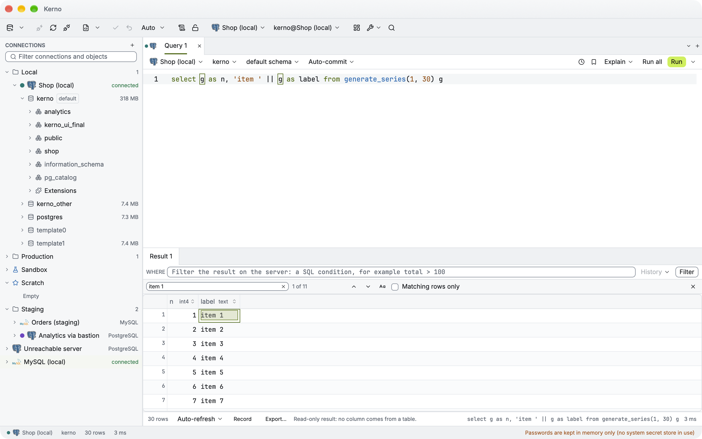
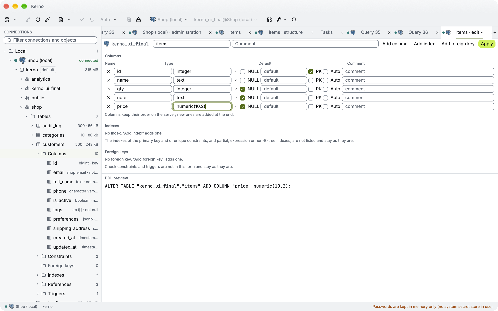

<p align="center">
  <picture>
    <source media="(prefers-color-scheme: dark)" srcset="assets/brand/kerno-horizontal-reversed.svg">
    
  </picture>
</p>

<p align="center">
  A fast, native database client for macOS and Linux.<br>
  PostgreSQL, MySQL, MariaDB and SQLite. Written in Rust. Open source.
</p>

<p align="center">
  <b>English</b> · <a href="README.fr.md">Français</a> · <a href="README.es.md">Español</a> · <a href="README.ko.md">한국어</a>
</p>

<picture>
  <source media="(prefers-color-scheme: dark)" srcset="docs/screenshots/final/query-results-dark.png">
  
</picture>

Kerno is a database client that opens at once and stays responsive: it is a native app, not a web page in a
window. It has the breadth of DBeaver (schema tree, SQL editor, data editing, structure editor, backup,
administration) in a calm interface, light or dark.

| | |
|---|---|
| **Starts in 0.3 s** | 264 ms from launch to a usable window |
| **Stays light** | about 150 MB of memory with a connection and a query tab open |
| **Scrolls a million rows** | at the screen's full rate (8.4 ms a frame on a 120 Hz display) |
| **Shows rows at once** | the first rows appear 3 to 6 ms after the server starts sending |
| **Every query can be cancelled** | and results arrive in pages, so memory follows what you look at |
| **Nothing leaves your computer** | no telemetry, no analytics, no crash upload |

Measured on an Apple M3 Pro; the method and every number are in [docs/BENCH.md](docs/BENCH.md).

## Contents

- [Install](#install)
- [First steps](#first-steps)
- [A tour](#a-tour)
- [Privacy](#privacy)
- [Performance](#performance)
- [Documentation](#documentation)
- [Build from source](#build-from-source)
- [Status](#status)
- [Licence](#licence)

## Install

Download the file for your system from the
[latest release](https://github.com/EvanPluchart/kerno/releases/latest). `SHA256SUMS` in the release lists the
checksum of each file.

### macOS (Apple Silicon)

1. Open `Kerno-<version>-macos-arm64.dmg` and drag Kerno to Applications.
2. The first time, macOS says it cannot check the app, because the build is not notarized by Apple. Open
   System Settings ▸ Privacy & Security and click **Open Anyway**. From a terminal:
   `xattr -dr com.apple.quarantine /Applications/Kerno.app`.

### Linux (x86_64 and arm64)

| Package | Install |
|---|---|
| `kerno_<version>_amd64.deb`, `kerno_<version>_arm64.deb` | `sudo apt install ./kerno_<version>_amd64.deb` (Debian, Ubuntu and their derivatives) |
| `kerno-<version>-linux-x86_64.tar.gz`, `…-aarch64.tar.gz` | `tar -xzf kerno-<version>-linux-x86_64.tar.gz -C ~/.local --strip-components=1`, then run `~/.local/bin/kerno` |
| `Kerno-<version>-x86_64.AppImage`, `…-aarch64.AppImage` | `chmod +x Kerno-<version>-x86_64.AppImage`, then run it |

The packages run on any distribution with **glibc 2.31 or newer** (Ubuntu 20.04, Debian 11 and later). The
libraries they need and the AppImage's options are in the [guide](docs/GUIDE.md#linux).

### Windows (x86_64, preview)

`Kerno-<version>-windows-x86_64-setup.exe` installs Kerno for your account only, without administrator rights,
with a Start menu entry and an uninstaller. `kerno-<version>-windows-x86_64.zip` is the same app with nothing to
install: unpack it and run `kerno.exe`. Windows may warn about an unknown publisher (SmartScreen: **More info**,
then **Run anyway**): the files are not signed.

It is a preview: its tests run on Windows against real PostgreSQL and MySQL servers at every change, and the
installer and the update are tried there by scripts, but nobody has used it by hand on a Windows desktop yet.
Kerno checks for updates there and installs them; your installed `pg_dump` and `mysqldump`, libpq's
`pgpass.conf` and the system's OpenSSH are used as on the other systems. What is left is on the
[roadmap](docs/ROADMAP.md).

## First steps

1. **Add a connection**: press <kbd>Cmd</kbd>+<kbd>N</kbd> (<kbd>Ctrl</kbd>+<kbd>N</kbd> on Linux), pick the
   engine, fill in host, user and password, then **Test connection** and **Save and connect**. You can also
   paste a URL, or start Kerno with one: `kerno postgres://ada@db.example.com:5432/shop`.
2. **Browse**: open the connection in the sidebar. A double click on a table opens its rows.
3. **Query**: <kbd>Cmd</kbd>+<kbd>T</kbd> opens a query tab, <kbd>Cmd</kbd>+<kbd>Enter</kbd> runs the
   statement at the cursor, <kbd>Cmd</kbd>+<kbd>.</kbd> cancels it.
4. **Find anything**: <kbd>Cmd</kbd>+<kbd>K</kbd> opens the command palette, which lists every action with
   its shortcut.

## A tour

### Connect to anything you can reach

<picture>
  <source media="(prefers-color-scheme: dark)" srcset="docs/screenshots/final/v11-ssh-openssh-dark.png">
  
</picture>

- SSL/TLS in every mode, with your certificates.
- SSH tunnels through your own OpenSSH: the hosts of `~/.ssh/config`, jump hosts and bastion chains, SSH
  agents such as 1Password, and every key type. A built-in client covers password logins.
- Passwords are saved encrypted, in Kerno's own file or the system keychain, as you choose. They can also
  come from a command, AWS RDS IAM, 1Password, `~/.pgpass` or `~/.my.cnf`.
- When a connection fails, Kerno first says what happened in plain words (host not found, connection
  refused, wrong password, TLS failure) and what to try, then shows the server's own message.

### One tree for everything

<picture>
  <source media="(prefers-color-scheme: dark)" srcset="docs/screenshots/final/navigator-dark.png">
  
</picture>

Folders and connections are the roots. Opening a connection shows its databases, schemas, tables, views,
functions and the rest, loaded as you open them. Folders have a colour and an icon. Every row answers a
right-click: open data, open structure, generate SQL, rename, drop, backup, and more.

### Write SQL

<picture>
  <source media="(prefers-color-scheme: dark)" srcset="docs/screenshots/final/explain-plan-dark.png">
  
</picture>

- Completion that knows your schemas, tables, columns and foreign keys.
- Run the statement at the cursor, the selection, or the whole script, with one result per statement, in
  tabs or stacked in one panel.
- EXPLAIN and EXPLAIN ANALYZE as a readable tree, with the slowest step marked.
- Transactions per tab, query history, saved queries, parameters, a formatter, find and replace, several
  cursors, and an optional vim mode.
- Run one script on several connections at once, each under its own rules.

### Read results, however large

<picture>
  <source media="(prefers-color-scheme: dark)" srcset="docs/screenshots/final/v11-grid-find-dark.png">
  
</picture>

Results stream in and only what is on screen is drawn, so a million rows scroll smoothly. Find a value in
the fetched rows, sort, hide and pin columns, and look at long text, JSON or binary values in a viewer. Copy
as CSV, JSON, Markdown or SQL, and export to CSV, JSON, SQL, Markdown or Excel.

### Edit data without surprises

<picture>
  <source media="(prefers-color-scheme: dark)" srcset="docs/screenshots/final/table-data-pending-edits-dark.png">
  
</picture>

Edit cells in place, add, duplicate and delete rows. Nothing is written until you ask: pending changes are
highlighted, **Review SQL** shows the exact statements, and **Apply** runs them in one transaction. If one
fails, everything is rolled back and your edits are kept. A value can also be a SQL expression such as
`now()`.

### Design tables

<picture>
  <source media="(prefers-color-scheme: dark)" srcset="docs/screenshots/final/structure-editor-dark.png">
  
</picture>

Create and alter tables in a form (columns, indexes, foreign keys, comments) with a live preview of the SQL,
applied after you confirm. Views, functions and procedures open as source you can edit.

### See how tables relate

<picture>
  <source media="(prefers-color-scheme: dark)" srcset="docs/screenshots/final/v11-er-diagram-dark.png">
  
</picture>

An ER diagram of a schema, or of a table and its neighbours, drawn from the foreign keys. Pan, zoom, open a
table with a double click, and export to SVG, PNG or Mermaid.

### Production stays safe

<picture>
  <source media="(prefers-color-scheme: dark)" srcset="docs/screenshots/final/chrome-production-dark.png">
  
</picture>

Each connection has an environment (local, staging, production, or your own) with a colour that tints the
window while it is active, and rules. Destructive statements always show their SQL and ask first; production
asks a second time on any write. A connection can be read-only, in the app and on the server.

### Move data

<picture>
  <source media="(prefers-color-scheme: dark)" srcset="docs/screenshots/final/v11-transfer-mapping-dark.png">
  
</picture>

- Copy tables with their rows to another connection, between PostgreSQL, MySQL and MariaDB in any direction,
  with the type of each column shown and editable.
- Backup and restore through `pg_dump`, `pg_restore`, `psql`, `mysqldump` and `mysql`, as step-by-step
  wizards that can be saved as tasks.
- Import CSV into a new or existing table.
- Export your connections, folders and settings to a file with no password in it, and import them elsewhere.

### An AI assistant, only if you want one

<picture>
  <source media="(prefers-color-scheme: dark)" srcset="docs/screenshots/final/v11-ai-write-sql-dark.png">
  
</picture>

Off until you turn it on. It talks to the endpoint you choose, a local model first (Ollama, LM Studio), and
only when you click Send. It can write SQL from a sentence and explain a query, a plan or an error. It sends
the names of your tables and columns, never your rows unless you tick a box for that request, and it shows
the exact content before sending. It never runs anything: it inserts SQL for you to read and run.

### And also

An administration view (sessions, locks, roles, sizes, settings), a command palette, a main toolbar, three
tab layouts, a keymap file, and `kerno <url>` from the shell. The full list, with the test that covers each
item, is in [docs/FEATURES.md](docs/FEATURES.md).

## Privacy

Kerno sends nothing about you or your data. It makes two kinds of request besides the connections to your
databases:

- **The update check.** At launch and every 6 hours, one request to this repository's releases page, with
  no identifier; when a newer version is found, a second one reads that release's notes. Turn it off in
  Settings ▸ Updates or with `KERNO_NO_UPDATE_CHECK=1`.
- **The AI assistant**, only once you have turned it on, only to the endpoint you set, only when you ask.

Passwords, SSH passphrases and API keys are never written in plain text, nor in a log. On macOS Kerno keeps
them by default in its own encrypted file, in its data folder, with the key in a second file beside it: nothing
asks for your password, and a copy of the file shows nothing, but a program running under your account could
read both files, as with DBeaver or `~/.pgpass`. Settings ▸ Passwords can keep them in the macOS Keychain
instead: Kerno's builds are not signed with an Apple Developer ID, so the Keychain then asks for your login
password again after every update. On Linux they stay in the Secret Service by default. Details in the
[guide](docs/GUIDE.md#where-passwords-are-kept).

## Performance

Release build on an Apple M3 Pro, local servers, medians.

| Measure | Result |
|---|---|
| Cold start to a usable window | 264 ms |
| Memory at rest, one connection and one query tab | 150 MB |
| First rows on screen after the server starts sending | 3 to 6 ms |
| Scrolling 1,000,000 rows | 8.4 ms a frame (120 Hz) |
| 1,000,000 rows × 20 columns fetched in full | 340 MB (17 bytes a cell) |
| Scrolling a 300-column table | 8.3 ms a frame |
| Opening a schema of 1,200 tables | 103 ms |
| Running a 200 MB `.sql` file | 17.7 s, the window stays responsive, cancel in 0.1 s |
| Usable again after the server comes back | 1.0 s |

[docs/BENCH.md](docs/BENCH.md) has the method, the ranges and how to reproduce them.

## Documentation

- [Guide](docs/GUIDE.md): SSH, password sources, the AI assistant and what it sends, vim mode, updates,
  keyboard shortcuts and the keymap file.
- [Features](docs/FEATURES.md): everything that works, with its tests and screenshots.
- [Benchmarks](docs/BENCH.md), [architecture](docs/ARCHITECTURE.md), [roadmap](docs/ROADMAP.md),
  [decisions](docs/DECISIONS.md).
- [Contributing](CONTRIBUTING.md).

## Build from source

You need Rust (the toolchain is pinned in `rust-toolchain.toml`; rustup installs it) and, on macOS, the Xcode
command line tools.

```sh
cargo build --release -p kerno
cargo run --release -p kerno
```

On Debian or Ubuntu, install the system libraries first with `sudo scripts/install-linux-deps.sh`. Packaging,
the local checks and the test databases are described in the [guide](docs/GUIDE.md#build-from-source).

## Status

Version 2026.11.4. It covers PostgreSQL, MySQL, MariaDB and SQLite on macOS (Apple Silicon), Linux
(x86_64 and arm64) and, as a preview, Windows (x86_64); MySQL from 5.1 on, with what each old release lacks
said in the [guide](docs/GUIDE.md#supported-servers). Other engines, data compare and more are on the
[roadmap](docs/ROADMAP.md).

## Licence

MIT OR Apache-2.0, at your option: [LICENSE-MIT](LICENSE-MIT) and [LICENSE-APACHE](LICENSE-APACHE).
Third-party notices, including DBeaver and the engine logos, are in
[THIRD_PARTY_NOTICES.md](THIRD_PARTY_NOTICES.md).
