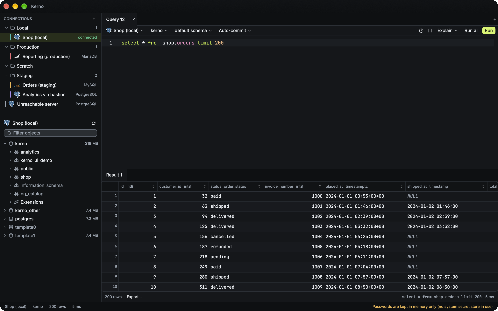
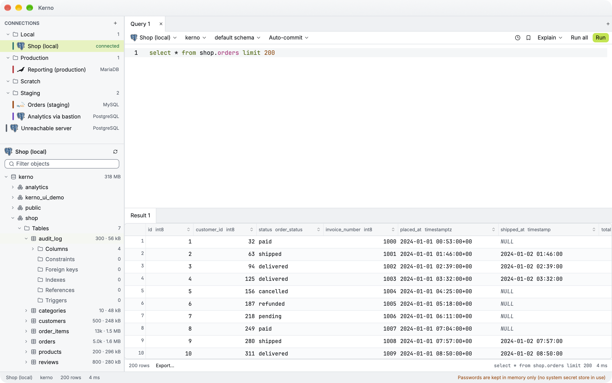
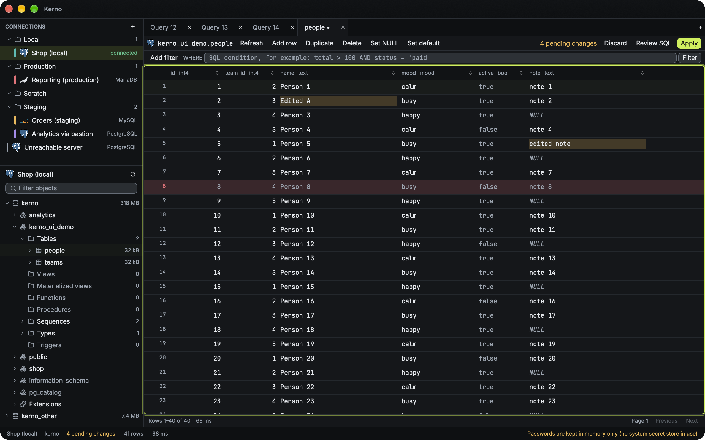
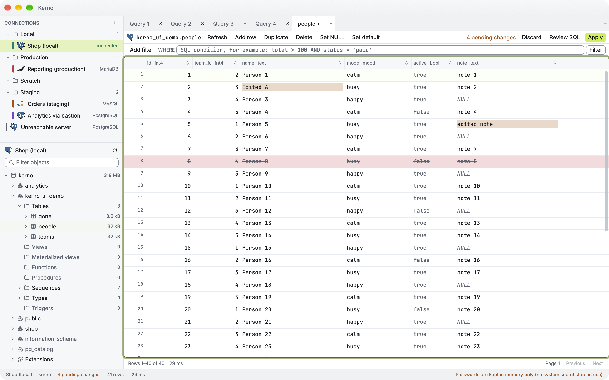
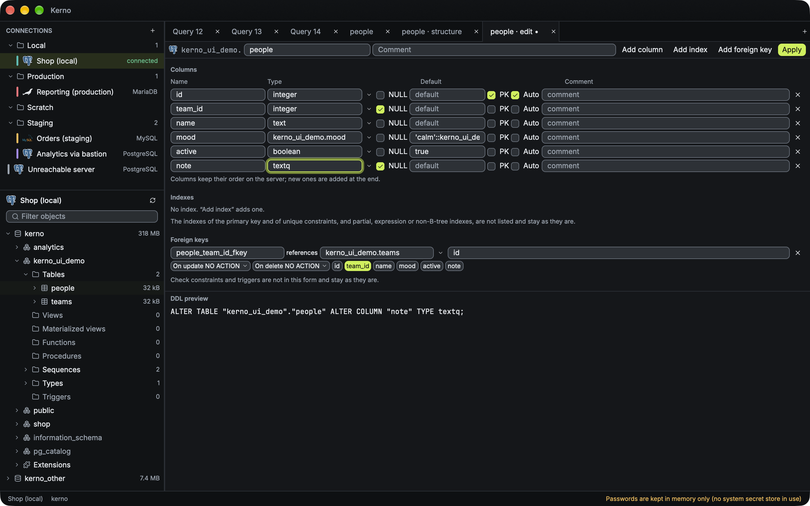
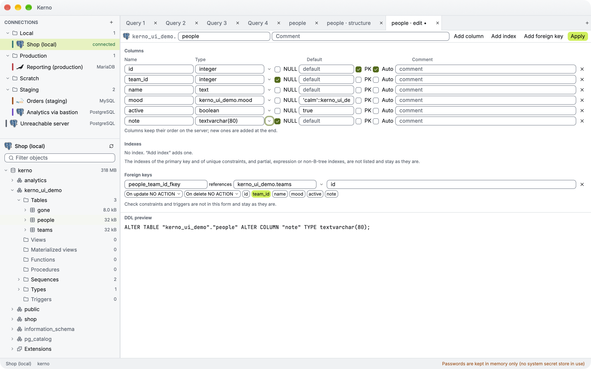
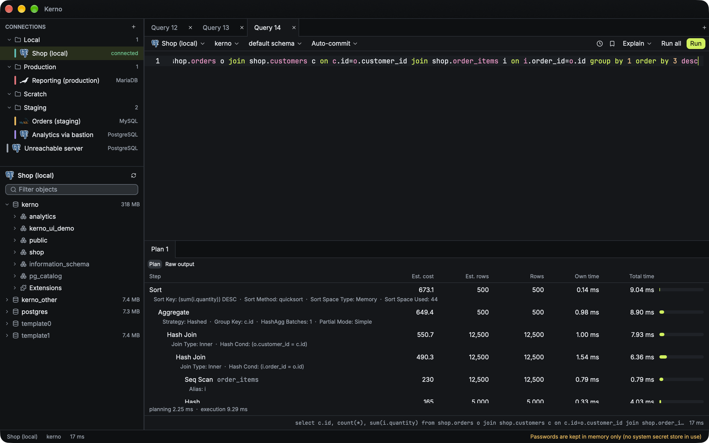
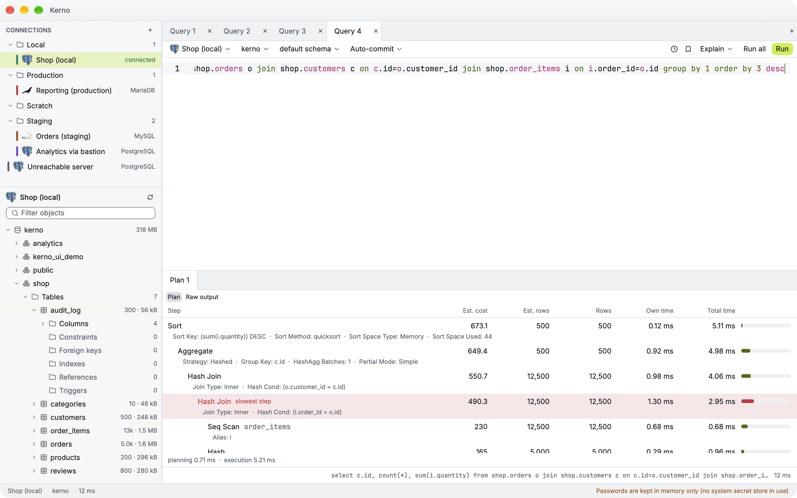
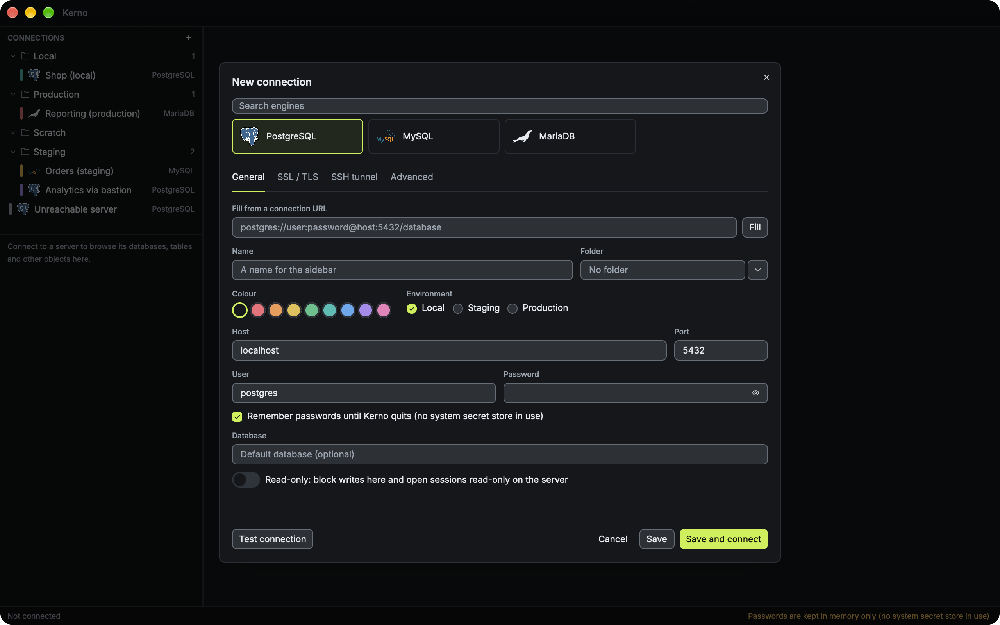
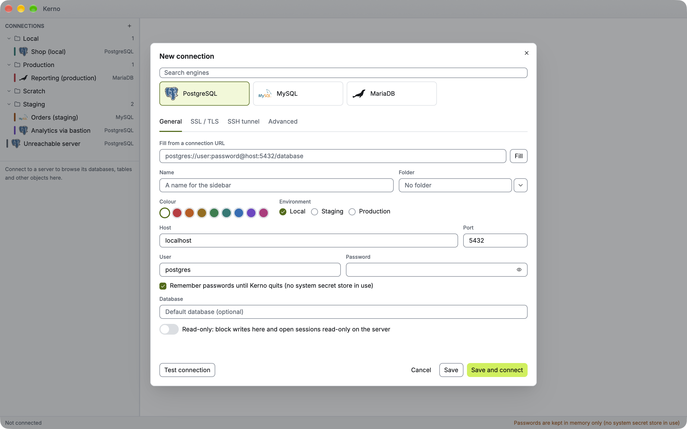

<p align="center">
  <picture>
    <source media="(prefers-color-scheme: dark)" srcset="assets/brand/kerno-horizontal-reversed.svg">
    
  </picture>
</p>

Kerno is a native, open-source database client for macOS and Linux, written in Rust with GPUI. All database,
file, SSH and secret-store work runs off the UI thread, results stream in pages and are drawn virtually, and
every running query can be cancelled. Nothing leaves the machine: no telemetry, no analytics, no update
pings, no crash upload.

Version 1 connects to PostgreSQL, MySQL and MariaDB. Its feature set and interactions follow DBeaver
Community; its look follows the calm, dense style of modern editors. Licensed under MIT OR Apache-2.0.

## Screenshots

| Dark | Light |
| ---- | ----- |
|  |  |
|  |  |
|  |  |
|  |  |
|  |  |

## What it does

The list of what works, with the tests that cover it, is [docs/FEATURES.md](docs/FEATURES.md). In short:

- Connections with SSL/TLS modes, SSH tunnels, a read-only flag and an environment tag; passwords live in
  the OS secret store.
- A lazy schema navigator, a SQL editor with schema-aware completion, a streamed results grid, EXPLAIN as a
  plan tree, per-tab transactions, query history and saved queries.
- A table data view with inline editing, SQL review and one-transaction apply; structure views and a form
  editor for tables.
- CSV and other exports, CSV import, backup and restore through the installed client tools, and an
  administration view (sessions, roles, sizes, settings).

Measurements: [docs/BENCH.md](docs/BENCH.md).

## Install

There is no published release yet. `scripts/bundle-macos.sh` builds `dist/Kerno.app` and a `.dmg` (ad-hoc
signed), and `scripts/bundle-linux.sh` builds a tarball with the binary, a `.desktop` file, icons and
licences. On Linux, unpack it into a prefix:

```sh
tar -xzf dist/kerno-<version>-linux-<arch>.tar.gz -C ~/.local --strip-components=1
```

Backup and restore call `pg_dump`, `pg_restore`, `psql`, `mysqldump` and `mysql` when they are installed;
nothing else needs them.

## Build from source

The repository pins its Rust toolchain in `rust-toolchain.toml`; rustup installs it on first use.

macOS: install the Xcode command line tools, then

```sh
nice -n 10 cargo build --release -p kerno
nice -n 10 cargo run --release -p kerno
```

Metal shaders are compiled at runtime, so the Metal toolchain is not required (see D-002 in
[docs/DECISIONS.md](docs/DECISIONS.md)).

Linux (Debian or Ubuntu): install GPUI's native dependencies as root, then build the same way.

```sh
sudo scripts/install-linux-deps.sh
nice -n 10 cargo build --release -p kerno
```

From macOS, `scripts/bundle-linux.sh` builds the Linux package inside Docker (`Dockerfile.linux-build`).
`.cargo/config.toml` caps cargo at 3 jobs.

## Test databases

The integration tests run against containers named `kerno-*`: PostgreSQL 17 (host port 55432), MySQL 8.4
(53306), MariaDB 11 (53307) and an SSH server (52222), all bound to 127.0.0.1 with test-only credentials.

```sh
scripts/test-env.sh up        # generate test certificates and keys, start, wait until seeded
nice -n 10 cargo test --workspace -- --test-threads=3
scripts/test-env.sh down      # stop and remove the containers
```

Tests skip with a message when a container is down; `KERNO_REQUIRE_CONTAINERS=1` makes that a failure.
Details in [CONTRIBUTING.md](CONTRIBUTING.md).

## Keyboard shortcuts

`Cmd` on macOS is `Ctrl` on Linux; `Ctrl` written alone is the Control key on both systems. Every action is also
reachable from the command palette.

| Shortcut | Action |
| -------- | ------ |
| Cmd+K | Command palette |
| Cmd+, | Settings |
| Cmd+N | New connection |
| Cmd+P | Open table (quick open) |
| Cmd+B | Toggle sidebar |
| Cmd+Alt+F | Filter the schema tree |
| Cmd+T | New query tab |
| Cmd+W / Cmd+Shift+W | Close tab / close all tabs |
| Ctrl+Tab / Ctrl+Shift+Tab | Next / previous tab |
| Cmd+O | Open SQL file |
| Cmd+S / Cmd+Shift+S | Save / save as |
| Cmd+Enter | Run statement |
| Cmd+Shift+Enter | Run all statements |
| Cmd+\ | Run statement in a new result tab |
| Cmd+Alt+Enter or Alt+P | Run the script from the cursor |
| Cmd+Alt+] / Cmd+Alt+[ (or Alt+Down / Alt+Up) | Go to the next / previous statement |
| Cmd+. | Cancel the running statement |
| Ctrl+Alt+N / Ctrl++ | Fetch more rows / fetch all rows |
| Ctrl+4 / Ctrl+8 | Commit / roll back the transaction |
| Ctrl+Alt+A | Switch between auto-commit and manual commit |
| Cmd+E / Cmd+Shift+E | Explain / explain analyze |
| Cmd+Y | Query history |
| Cmd+/ | Toggle line comment |
| Cmd+Shift+I | Format SQL |
| Cmd+Shift+/ | Toggle block comment |
| Cmd+Shift+X / Cmd+Shift+Y | Upper case / lower case |
| Ctrl+Space or Cmd+I | Show completions |
| F4 | Edit the selected object, connection, or open the table at the cursor |
| F2 / F5 | Rename / refresh the selected object |
| Cmd+C / Cmd+Shift+C | Copy object name / qualified name (navigator) |
| Cmd+] or Cmd+Alt+Enter | New query on the selected object (navigator) |
| Cmd+Shift+, | Link the schema tree with the editor |
| Cmd+R | Refresh rows (data view) |
| Alt+Insert | Add row (data view) |
| Cmd+Z | Undo last pending change (data view) |
| Shift+Enter | View the value of the selected cell |
| Tab | Toggle record view (data and result grids) |
| Ctrl+G / Ctrl+Shift+G | Go to row / go to column |
| Ctrl+F11 | Filter by distinct values of the column |
| Cmd+= / Cmd+- / Cmd+0 | Grid text larger / smaller / usual |
| Cmd+Q | Quit |

These are the defaults in `crates/kerno/src/actions.rs`; the full list is the command palette, and the
keymap file below lists every command id with its shortcuts.

### Changing shortcuts

The command "Open Keymap File" (command palette) creates `keymap.json` in Kerno's config directory (the
platform's config directory for "Kerno") if it does not exist, with every command id and its default
shortcut listed under `commands` for reference. Each entry of `bindings` replaces the shortcuts of one
command: one shortcut, a list of shortcuts, or `null` for none. `secondary` means Cmd on macOS and Ctrl on
Linux; a sequence of keystrokes is separated by spaces. Changes apply at the next start, and problems in
the file are reported when Kerno starts.

```json
{
  "bindings": {
    "new_query_tab": "secondary-shift-t",
    "close_tab": ["secondary-w", "ctrl-f4"],
    "toggle_sidebar": null
  }
}
```

## Roadmap

[docs/ROADMAP.md](docs/ROADMAP.md) lists what is outside version 1 and how each item would be built.
[docs/ARCHITECTURE.md](docs/ARCHITECTURE.md) describes the code.

## Licence

MIT OR Apache-2.0, at your option: [LICENSE-MIT](LICENSE-MIT) and [LICENSE-APACHE](LICENSE-APACHE).
Third-party notices, including DBeaver and the engine logos, are in
[THIRD_PARTY_NOTICES.md](THIRD_PARTY_NOTICES.md).
